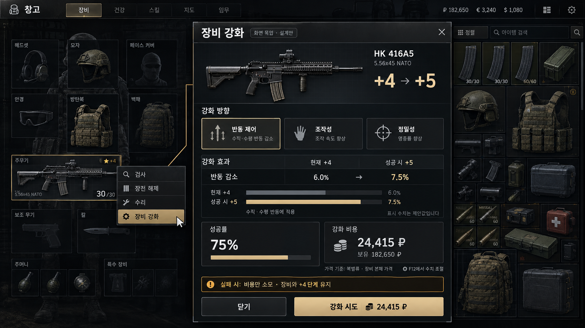
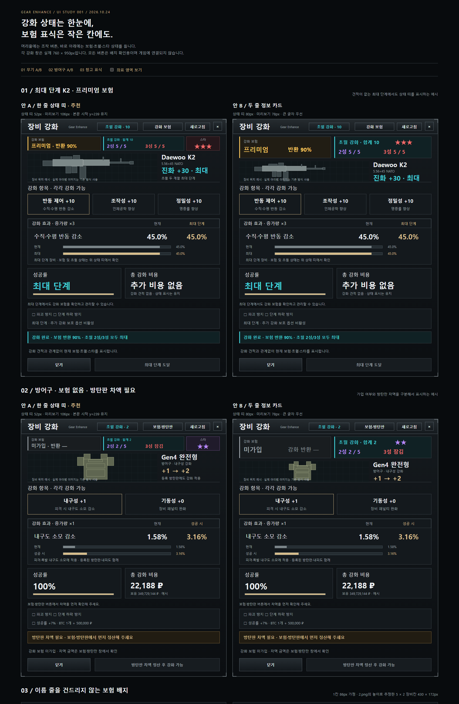
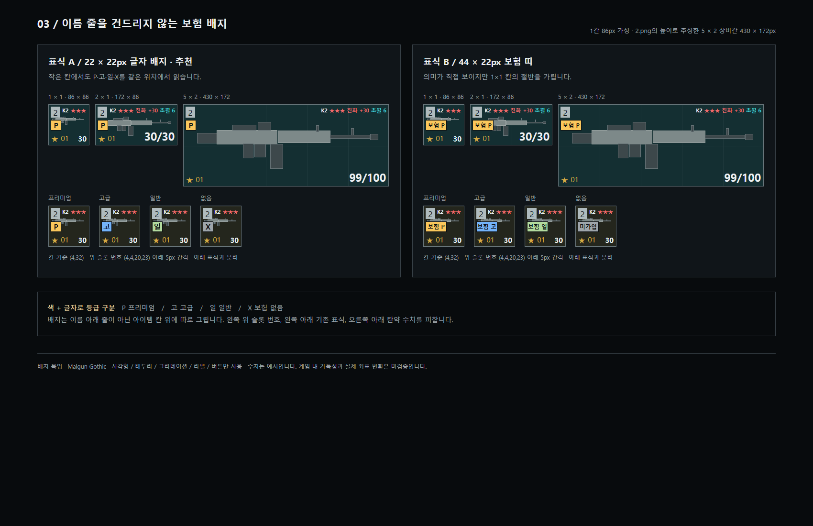

<p align="center">
  <a href="README.md"></a>
  <a href="README.en.md"></a>
</p>

## Changelog

The full changelog (47 entries) is in the [`changelog/`](changelog/) folder, 10 per file (higher number = newer, latest: [`CHANGELOG-005.md`](changelog/CHANGELOG-005.md)). Per-release summaries: [Releases](../../releases).

# Equipment Enhancement — Gear Enhance 1.4.3

[](https://buymeacoffee.com/real_feels)

If you enjoy the mod, please consider a donation: https://buymeacoffee.com/real_feels

A client and server mod for SPT **4.1.6**. Right-click a weapon or armor in your stash to open **장비 강화 (Enhance gear)**, review the selected attribute, effects, success chance, cost, and failure outcome, then make an attempt. Armor plates and soft armor are enhanced with their parent armor and have no separate menu.

**1.4.3**: EquipmentIsEternal compatibility — equipment returned by that mod after death keeps its enhancements, and no enhancement insurance copy is sent (server changes only).

**1.4.2**: Fixed enhancement records being erased after Terminal raids, overlapping level indicators in equipment slots, and clipped text in other languages. Mobility becomes Impact Absorption for armor with no penalties, reducing blunt damage.

**1.4.1**: Added Russian and Simplified Chinese, editable translation files and support for new languages in the `lang` folder, and settings for the stash insurance indicator's shape, position, and visibility (see [Languages](#언어-한국어--english--русский--中文) and [Enhancement insurance](#강화-보험-140) below).

**1.4.0 highlights**

- **Tabbed interface**: Choose regular enhancement, ★★, ★★★, Transcendence, ???/✦ Mythic, Insurance, Prestige, or Help in one window. The right panel compares original and enhanced equipment stats. For weapons, the **탄 비교 (Ammo comparison)** tab compares the loaded round's original, current, and next-level stats.
- **Success materials and instant enhancement**: Use up to two types of material from dogtags, graphics cards, and bitcoins to increase success chance. Pay an extra 50,000 ₽ to skip the charge-up for regular, Transcendence, and Mythic enhancements (not star evolution or ???).
- **Risk and protection**: Armor also risks destruction or a downgrade when attempting +6 or higher. Regular protection coefficients have been reduced to 10% for destruction and 7% for downgrades. Evolution destruction protection tickets cost 1,000,000 ₽ each for ★★ (up to 3), 2,700,000 ₽ for ★★★ (up to 2), and 5,000,000 ₽ for ??? (up to 1). These are lifetime purchase limits per item.
- **??? → Mythic**: With ★★★ equipment, pay 8,000,000 ₽ and one LEDX for a 50% chance. Success grants ✦ Mythic status, with up to five further levels. Mythic weapons gain +3% bullet damage and penetration per level and reduce ammo penalties by 16% per level. Body armor reduces incoming damage by 10% per level (half for head hits); head armor reduces it by 5%. Only the strongest reduction applies. Armor can gain up to two random extra protected areas, with rerolls available. **Mythic effects do not apply to bots.**
- **Enhancement insurance**: Standard offers 20% return chance after 24 hours, Advanced 55% after 12 hours, and Premium 99% with immediate return. If a successful enhancement or armor plate surcharge cancels coverage, you can renew by paying the new premium minus the amount already paid.
- **Prestige insurance**: Register equipment for 10% of its enhancement value to receive it by mail, still enhanced, **only when advancing to the next Prestige level**. It does not cover equipment lost in raids. If its value increases, pay only the difference. Registration is unavailable at maximum Prestige.
- **Tab alerts, markers, and effects**: Tabs glow pink for Prestige mail to claim and gold for unpaid Prestige differences or canceled enhancement insurance. You can update other equipment from the registered list. Stash items show level markers such as `✦ 신화` (✦ Mythic) and `[신화 V · 초월 X]` ([Mythic V · Transcendence X]), and Mythic slots have glowing borders. Added confirmation dialogs, result popups, and four Mythic sound effects.
- **Record protection and developer options**: Manually edited enhancement records are restored to the last valid state the next time the server starts. Developer options in the BepInEx Configuration Manager (F12) include rollback when locking/restarting and a separate password for saving changes (passwords are not public).

Design documents: [Detailed design](docs/DESIGN-1.4.0.md) · [One-page summary](docs/DESIGN-1.4.0-SUMMARY.md). Design documents and changelogs retain some values from before balancing; use the descriptions below for current defaults.

## Installation / Updating from 1.4.2

1. Close the server and game, and back up your profile.
2. Extract `GearEnhance-1.4.3.zip` into your SPT **4.1.6** folder, replacing both `BepInEx/plugins/GearEnhance/` and `SPT_Runtime/user/mods/GearEnhance/`.
3. **Update both the client and server to 1.4.3**, including `BepInEx/plugins/GearEnhance/fonts/` (Noto Sans KR, Rajdhani, and font licenses) and `lang/` (Russian, Chinese, and a blank translation template). Without the fonts, the old fonts are used. Without the `lang` folder, translations embedded in the DLL still work.
4. Restart the server and game. **The protocol version is 13.** Updating only one side blocks enhancement with a message asking you to update both; saved enhancement records are not deleted. All 1.4.1 records (including enhancement levels, star evolution, and Transcendence carried over from 1.3.0) and F12 settings are retained. 1.4.3 still uses protocol version 13. Its fixes are server-side only, but please update both sides to keep version displays consistent.

Downgrading to 1.2.0 or earlier disables Transcendence records and increased maximum durability handling. Keep client and server versions matched when downgrading, and retain your backups.

**1.3.0** added ① **Transcendence enhancement** for ★★ or better equipment (2-star and 3-star tracks, each with levels 0–5; see [Transcendence enhancement](#초월-강화-130)). ② Armor plates are **automatically covered by slot**: any plate worth no more than the paid-for plate is covered immediately for free, whether new or used. Only more expensive plates require a surcharge. ③ A **status strip** below the enhancement window header shows insurance tier and return chance, Transcendence level, and star status. Stash and equipment slots gained **insurance badges** (P·고·일·X, meaning Premium·Advanced·Standard·None), and buying enhancement insurance plays the game's insurance sound ([UI mockups](#화면-목업-130)). ④ Enhancement and Transcendence effects also work **in the hideout (shooting range)**. ⑤ Fixed registration buttons not responding in the insurance/plate window and insurance being blocked after market price increases even though all plates were covered.

**1.2.0** made ① **installed armor plates, soft inserts, and visors inherit their armor's enhancements and ★ markers** (these parts cannot be enhanced separately). Installed plate prices are added to armor enhancement costs, and only plates fitted during enhancement or registration receive effects. ② Added **enhancement insurance (Standard 20% · Advanced 55% · Premium 90%)**, purchased in the enhancement window instead of through traders. Equipment lost in a raid has that chance to return by mail **with its enhancements intact**; premiums depend on enhancement value. ③ Enhancement records erased while awaiting insurance in 1.0.0 are reconstructed from enhancement result records on return. ④ Mismatched client/server versions are blocked. **1.1.0** added **Korean/English** UI and F12 settings, and **preserved enhancement/star records on insured equipment and unsold or withdrawn flea market items returned by mail**. 1.0.0 was the first stable release. Weapons have three independently enhanced attributes (recoil, handling, precision), and armor has two (durability, mobility). After maximizing all attributes, you can evolve to ★★ or ★★★ (2× or 3× effects). Weapon attempts at +6 and above risk destruction or downgrades on failure; destruction protection, downgrade protection, and bitcoin success boosts are available. Enhanced equipment is marked in the stash with a gold ★, purple ★★, or red ★★★.

<a id="언어-한국어--english--русский--中文"></a>

## Languages (한국어 / English / Русский / 中文)

Choose **`0. Language · 언어` → `Language · 언어`** at the top of the BepInEx Configuration Manager (F12). You can also switch directly with the `한국어 · EN · RU · 中文` buttons at the top of the enhancement window.

| Value | Behavior |
|---|---|
| `Auto` (default) | Korean if the Windows display language is Korean; Russian for Russian, Ukrainian, or Belarusian; Chinese for Chinese; otherwise English |
| `Korean` | Always Korean |
| `English` | Always English |
| `Russian` | Always Russian (1.4.1) |
| `Chinese` | Always Simplified Chinese (1.4.1; uses Windows Chinese fonts in the window) |
| `Custom` | A custom translation file in the `lang` folder (1.4.1; see below) |

### Edit translation files / Translate it yourself (1.4.1)

- `BepInEx/plugins/GearEnhance/lang/` contains `ru.tsv`, `zh.tsv`, and `template.tsv`. These are UTF-8, tab-separated tables that can be opened in Excel, Google Sheets, or Notepad. Columns: `ko` (key; do not edit), `en` (reference), and `text` (translation).
- Editing `ru.tsv` or `zh.tsv` overrides the DLL's translation for that row. Updates overwrite these files, so keep edited copies under different names.
- New language: copy `template.tsv` to a name such as `de.tsv`, fill the `text` column, and set F12 `Language = Custom` + `Custom language file = de.tsv`. Blank cells and `-` fall back to English. Preserve placeholders such as `{0}` and `{1:N0}`, and leading/trailing spaces. Write line breaks as `\n`.
- EN: open the files in `BepInEx/plugins/GearEnhance/lang/` (UTF-8, tab-separated: `ko`, `en`, `text`). Edit the `text` column; keep `{0}` placeholders and leading/trailing spaces. For a new language copy `template.tsv`, fill it, and set F12 `Language = Custom` and `Custom language file` to its name.

- The enhancement, evolution, and result windows, right-click menu (`Enhance gear`), stash markers (`★★ Evolved +30`), and server error messages change immediately. An information line already displayed in an open window changes with the next message.
- F12 setting names, categories, and descriptions also change. **Close and reopen the F12 window** to apply them (the configuration manager rereads text when opening).
- Keys in the settings file (`rf.gearenhance.cfg`) retain their original Korean names, so switching languages does not reset values. Options such as `기준 가격` (Base price) and `실패 처리` (Failure handling) already use English values (`Handbook`, `KeepItem`, etc.).
- Diagnostic messages in LogOutput.log remain Korean (only server return-mail linking logs include both Korean and English).
- English text was kept short to fit the available space and roughly checked using font widths, but clipping in the actual game UI has not yet been checked.

<a id="화면-구성"></a>

## Interface layout



The image above is an early design mockup, not an actual game screenshot. 1.4.0 uses left-side tabs for enhancement, evolution, Transcendence, Mythic, and insurance; the middle shows attribute cards, success chance, cost, and failure information; the right shows equipment stats. The full reference size is 1192×980 including the right panel, scaled down to fit the screen. Action buttons stay fixed at the bottom. See the [1.4.0 mockup](docs/mockup/gear-enhance-1.4.0.html) for the current layout design.

## Enhancement effects

Weapons have **three attributes: Recoil Control, Handling, and Precision**. Armor has **two: Durability and Mobility**. Each is enhanced separately, and all effects apply together. For example, a weapon with Recoil +10 can still raise Handling separately from +0.

| Equipment | Attribute | Regular +10 effect | ★★ effect ×2 | ★★★ effect ×3 |
|---|---|---|---|---|
| Weapon | 반동 제어 (Recoil Control) | 15% less vertical/horizontal recoil | 30% less | 45% less |
| Weapon | 조작성 (Handling) | +10 ergonomics | +20 | +30 (final cap: 100) |
| Weapon | 정밀성 (Precision) | 10% less bullet/pellet spread | 20% less | 30% less |
| Armor | 내구성 (Durability) | 30% less durability loss | 60% less | 80% less (cap) |
| Armor | 기동성 (Mobility) | 20% lower equipment penalties | 40% lower | 60% lower |

Since 1.4.2, armor whose body and installed plates have no movement, turning, or ergonomics penalties replaces Mobility with **충격 흡수 (Impact Absorption)**. It reduces **blunt damage** by the same percentages (shown in the enhancement window and stats panel; evolution requirements are unchanged).

**Maximizing the first star and completing evolution are separate milestones.** Maximizing all three weapon attributes or both armor attributes only meets the evolution requirement. You must succeed in the **★★성 (2-star) tab** to gain double the base enhancement effects and a purple **`★★`** marker. Merely reaching the regular maximum grants no automatic bonus. After successful ★★ evolution, if all attributes are at maximum, you can attempt the **★★★성 (3-star) tab**. The third star gives 3× base effects; it does not stack with the second star's 2× to make 6×. Reductions are capped at 80%, and added ergonomics at 50. For example, 3-star armor durability reduces loss by 80%, rather than 90%.

Enhancement levels from 0.4.x are retained, but the automatic completion bonus is replaced by a separate successful evolution. Evolution is saved separately and does not stack again on reconnecting.

Early levels give equal increases; after the halfway point, the per-level gain curves from 1× to 4×. The total gain is distributed across the maximum level, so the base +10 effects match the table above. Recoil +1 through +5 each add about 0.79 percentage points; the last step, +9→+10, adds about 3.16. **Existing levels are retained, but intermediate effects are recalculated using the new curve**, so they differ from earlier versions.

| Attempted level | Base success chance | Gain multiplier for this level | Cumulative recoil reduction (before evolution bonus) |
|---|---|---|---|
| +1 | 75% | 1× | 0.79% |
| +2 | 70% | 1× | 1.58% |
| +3 | 65% | 1× | 2.37% |
| +4 | 60% | 1× | 3.16% |
| +5 | 55% | 1× | 3.95% |
| +6 | 50% | 1.6× | 5.21% |
| +7 | 45% | 2.2× | 6.95% |
| +8 | 40% | 2.8× | 9.16% |
| +9 | 35% | 3.4× | 11.84% |
| +10 | 30% | 4× | 15% |

Changing the maximum level also changes the curve and halfway point. The maximum base effect is the smaller of `단계 기본값 × 최대 단계` (base value per level × maximum level) and the effect cap; a successful evolution bonus is then applied. Final reductions cannot exceed 80%, or added ergonomics 50.

Effects apply only to the specific item ID. They do not overwrite the original template or existing repair buffs. Recoil modifies the weapon component after attachment multipliers; separate camera recoil is unaffected. Precision changes only ammo spread, Durability only actual durability loss, and Mobility only negative equipment penalties.

### Installed armor plates (1.2.0)

- **Installed armor plates, soft inserts, and visors** (parts in armor slots) inherit their armor's Durability and Mobility enhancements and show the same ★ marker in stash and inspection views.
- **Cost**: Armor enhancement and evolution costs use the price of `본체 + 지금 끼운 부품` (body + currently installed parts). Weapons still use only the body price. The price basis shows `본체+끼운 방탄판` (body + installed plates).
- **Coverage by slot**: Armor remembers **the plate value paid for so far**, rather than tracking each individual plate. This prevents cheaply enhancing with inexpensive plates and simply switching to expensive ones.
  - **Automatic since 1.3.0**: Fitting a plate into enhanced armor immediately applies the armor's levels for free if the plate is **worth the same or less than the paid-for plate, whether new or used**. Coverage is also reconciled when opening the enhancement, insurance, or plate window. Plates fitted during a raid are covered after the raid ends. Disable this with F12 `1. 기본 → 방탄판 자동 등록` (1. General → Automatic plate registration; on by default).
  - **More expensive plates** are not covered automatically, and a message says you must pay the difference to receive enhancement effects. Pay with `차액 내고 적용` (Pay difference and apply) in the `보험·방탄판` (Insurance/plates) window, or have it added to the next enhancement cost. Once paid, plates up to that value can be swapped freely.
- **Surcharge**: If the current parts cost more than those paid for so far, the price difference is charged once as `방탄판 차액` (Plate surcharge). **Since 1.3.0, each level already earned is charged for its average number of attempts (1 ÷ that level's success chance)**, including ★★ evolution and Transcendence, with its pity system included. The aim is to match what a player would pay on average if using those plates from the beginning. Example: plates worth 50,000 → 300,000 ₽ at +10 cost about 2,040,000 ₽ (about 830,000 in 1.2.0), plus 2,500,000 ₽ for ★★ (750,000 in 1.2.0). Adjust with the developer option `방탄판 차액 배율` (Plate surcharge multiplier; default 100%). Registering equal or cheaper plates is free.
- **2-star Transcendence maximum durability (1.3.0)**: Covered plates also gain increased maximum durability, including new plates bought from traders. While removed and kept in the stash or a bag, the number remains but the effect does not apply (briefly removing and refitting them does not clip durability). **When fitted into different armor** (after the raid if done in a raid), the bonus is removed and any excess current durability is clipped. Refitting them into the original armor restores only the maximum (preventing free repairs).
- **Plates, soft armor, and helmet protection attachments such as visors cannot be enhanced separately.** They have no `장비 강화` (Enhance gear) right-click option, and the server rejects attempts. Enhance or register their parent armor while they are fitted to inherit its levels. This prevents mismatches such as +1 armor with a +4 plate.
- Plates enhanced separately before 1.2.0 **retain their records, but have no independent effect**. They cannot be enhanced further and use only their parent armor's level when fitted (their own level is ignored, and their own ★ marker is hidden).
- Plates removed into rig pockets or a bag receive no effects. Weapon attachments do not inherit weapon enhancements.
- Armor enhanced before 1.2.0 registers its currently fitted parts for free when first seen after updating.

<a id="강화-보험-140"></a>

### Enhancement insurance (1.4.0)

Purchase coverage in the **보험 (Insurance) tab** on the left of the enhancement window. It is separate from trader insurance, and its return conditions also differ from Prestige insurance.

- The game's right-click menu gains only `장비 강화` (Enhance gear); enhancement insurance and plate registration are handled inside that window. The Insurance tab shows your tier, registered equipment, and time remaining until returns. Premium shows `즉시` (Immediate).
- The header shows current enhancement insurance in its tier color (`강화 보험 고급 55%` (Enhancement insurance: Advanced 55%) / `강화 보험 없음` (No enhancement insurance)).
- Since 1.3.0, the status strip below the header always shows insurance tier and return %. **Since 1.4.1, stash/equipment indicators are small triangles in the bottom-left corner** (gold for Premium, blue for Advanced, green for Standard), shown only on insured equipment. Under F12 `1. 기본` (1. General), use `창고 보험 표시 모양` (Stash insurance indicator shape: corner triangle `Corner`, 1.4.0 letter box `Letter`, `Dot`, `[P]` beside the name with `Name Tag`, or `Off`), `창고 보험 표시 위치` (Stash insurance indicator position: `Bottom Left`, `Top Left`, `Beside Count`), and `보험 없는 강화 장비에도 표시` (Also show on uninsured enhanced equipment; gray when enabled, or X for letter boxes). To restore the 1.4.0 look, choose `Letter` + `Top Left` and enable uninsured indicators. Buying coverage plays the game's insurance sound.
- Text colors: Standard = light green, Advanced = blue, Premium = orange-gold. Green indicates a good result (returned enhanced, all plates registered); orange indicates caution (unregistered plates, consumed insurance, plate surcharge); red indicates loss (trader return at +0, enhancements lost).

| Tier | Chance to return enhanced after loss in a raid | Default premium (% of enhancement value) | Return delay after a successful roll (real time) |
|---|---|---|---|
| Standard | 20% | 5% | 24 hours |
| Advanced | 55% | 15% | 12 hours |
| Premium | 99% | 30% | Immediate |

- **Enhancement value** is the sum of base costs and material values up to the current levels, star status, Transcendence, and Mythic status (including registered plate prices for armor). Higher levels mean higher premiums. Costs are subject to a minimum and a maximum of 100 million roubles per transaction.
- At raid end, each missing enhanced item (death or left behind) is rolled against its tier's chance. On success, **the equipment and slotted parts (attachments, magazines, plates)** return **by mail after the tier's delay**, retaining enhancements, stars, Transcendence, Mythic status, and plate registration (excluding ammunition and pocket contents). The same equipment is removed from trader insurance returns to prevent duplicates.
- If the roll fails or there is no enhancement insurance, **enhancements are lost**. Trader insurance can still return the item as usual, but as ordinary +0 equipment. **Trader insurance alone does not restore enhancements.**
- Coverage is consumed after one loss. A successful enhancement or payment for more expensive plates cancels coverage; the result popup and Insurance tab show **보험이 풀렸습니다. 다시 가입하세요 (Insurance canceled. Please renew.)** Since 1.4.0, renewing or upgrading costs only **`새 보험료 − 그 장비에 이미 낸 보험료`** (new premium − premium already paid for that item; minimum 0 ₽). You cannot repurchase while valid insurance of the same or a higher tier exists. Payment history ends on raid return; the next policy is calculated afresh.
- If any coverage has been canceled, the tab glows **gold** and shows `다시 가입 N개` (N items to renew). Each row in the `등록된 장비` (Registered equipment) list can be renewed, even if it is not the item currently selected in the window.
- **Using EquipmentIsEternal (1.4.3)**: On death, that mod restores raid-start equipment as the same items. When it is installed on the server, equipment it will actually restore (following its insured-only setting and its armband, scabbard, secure container, and special-slot rules) is not treated as lost: **enhancements remain even without enhancement insurance**, coverage is not consumed, and no return mail is sent. Equipment it does not restore, such as items newly found in the raid, follows the rules above. The server logs `EquipmentIsEternal이 사망 후 장비를 되돌립니다 — 강화 장비 N개 기록 유지` (EquipmentIsEternal restores equipment after death — retaining N enhanced item records). **Trader-insured equipment may still produce an extra +0 item from the trader, separately from the item restored by that mod.** This is an interaction between that mod and SPT's normal insurance; this mod does not prevent it, so users of that mod must accept it (the copy also lacks Transcendence's increased maximum durability). If you disable its duplicate-item cleanup (`DeduplicateItems`), move a plate to another slot in a raid, and die, the returned plate may receive the Transcendence durability bonus twice (not applicable with default settings).
- Equipment already lost and awaiting trader insurance before installing 1.2.0 returns with its enhancements under the old 1.1.0 rules.
- The return chance is fixed when you buy coverage. The table above lists 1.4.0 defaults; existing policies use the conditions at purchase.

### Prestige insurance (1.4.0)

Register enhanced equipment in the **프레스티지 (Prestige) tab** to receive it by system mail **only when completing Prestige and advancing to its next level**. This insurance does not return equipment lost through death or left in a raid.

- The default premium is **enhancement value × 10%**. Enhancement, ★, Transcendence, and Mythic records, attachments, and plates are preserved. Registration is unavailable at maximum Prestige (currently 6), as there is no next level.
- Registration remains after further enhancement or plate changes. If value increases, pay only **the new premium minus the amount already paid**. Decreases do not produce refunds. Without paying the difference, returns use **the enhancement records covered by the last payment**.
- Registration ends after return. Register again to carry the item through the next Prestige. Items selected for SPT's default transfer return once without duplication and retain their enhancement records. Registrations made while developer options are unlocked are not transferred.
- The tab pulses **pink** when return mail is waiting and **gold** when an additional payment is due. Pay each item's difference and update coverage in the `등록된 장비` (Registered equipment) list.

## High-risk enhancement

High-risk rules apply **when the next level attempted for the selected weapon or armor attribute is +6 or higher** (starting at +5→+6; armor included since 1.4.0). They apply even if other attributes are +0. Up to +4→+5, failure only consumes costs under default settings. Changing the maximum level does not move the +6 risk threshold.

- Success: selected attribute +1.
- 25% of failures: destroy the body, attachments, magazines, and ammunition, and remove insurance and enhancement records.
- Remaining 75% of failures: selected attribute -1; other attributes and equipment durability are retained.
- After falling to +5, retrying +5→+6 still uses high-risk rules and protection options. After falling from +5 to +4, the next +4→+5 attempt is in the regular range.

The destruction chance is **a proportion of failed attempts**. Attempting Recoil +5→+6 gives 50% success, 12.5% destruction, and 37.5% downgrade, regardless of the other two attributes. The window shows both destruction's share of failures and its overall chance on this attempt. If destruction remains possible after protection, a confirmation dialog appears. The always-succeed option also guarantees 100% success in the high-risk range.

1.4.0 high-risk rules apply to both weapons and armor. Developer options can disable high-risk enhancement or adjust destruction's share of failures.

## Enhancement protection options

Select **파괴 방지 (Destruction protection)** and **단계 하락 방지 (Downgrade protection)** independently in the enhancement window. They are available only when the next level of the selected attribute is +6 or higher and the corresponding loss is possible. Both are available when retrying +5→+6. At +4→+5 or below, selection and protection charges are disabled.

- Destruction protection: retains the equipment, attachments, and all enhancement levels on a destruction roll. It does not prevent downgrades.
- Downgrade protection: retains the level on a downgrade roll. It does not prevent destruction.
- Both: neither destruction nor downgrade occurs; failure consumes only the base enhancement cost and protection fees. The success chance itself does not increase.

Protection cancels only its corresponding outcome; it does not convert it into another loss or reroll for success. Protection fees are charged on every attempt, regardless of success, failure, or activation. When there is no corresponding loss to protect against—100% success, cost-only failure, or a downgrade at +0—the checkbox is disabled and no fee is charged. These options do not protect against the zero-durability setting.

Each extra fee is `기본 강화비 × 시도 단계² × 보호 계수` (base enhancement cost × attempted level² × protection coefficient), rounded up. 1.4.0 defaults are **10% for destruction and 7% for downgrades** (one-fifth of 1.3.0). Both fees are calculated independently from the base cost, then added.

| Attempt | Base cost | Extra destruction protection | Extra downgrade protection | Total with both |
|---|---|---|---|---|
| +5→+6 | 30,518 ₽ | 109,865 ₽ | 76,906 ₽ | 217,289 ₽ |
| +10 | 74,506 ₽ | 745,060 ₽ | 521,542 ₽ | 1,341,108 ₽ |

These examples assume a 100,000 ₽ base price, default costs, and high-risk conditions (armor base prices include installed plates). The window shows base/protection/total costs and remaining risk after protection; changing a checkbox requests a new server quote. Totals above 100 million roubles are rejected before payment. If destruction protection removes all actual destruction risk, no separate destruction confirmation is needed.

## Star evolution — ★ → ★★ → ★★★

**Only equipment with all first-star attributes at maximum** can attempt the ★★ tab. With the default +10 maximum, all three weapon attributes or both armor attributes must each be +10; the server checks this again.

- Base success chance: 30%. Cost: **the greater of 2 million roubles or 3× the body's base price**. A 100,000 ₽ body costs 2 million; a 1 million ₽ body costs 3 million. A regular minimum cost set above 2 million also applies.
- Success: retains attribute levels, doubles enhancement effects, and grants the purple `★★` marker.
- Failure: without a protection ticket, removes the equipment body, attachments, magazines, ammunition, insurance, and enhancement records.
- **Since 1.4.0, evolution-specific destruction protection tickets** are available. They are separate from regular enhancement protection checkboxes. If destruction is still possible after protection, a confirmation dialog appears.
- Equipment that succeeds at the second star can attempt the third; no further evolution is possible after the third. Successful evolution is stored separately from regular attribute levels.

### Third-star evolution — ★★ → ★★★

- **Only equipment that has successfully reached the second star and has all attributes at the current maximum** can attempt it. The server rejects requests to skip directly from the first star to the third.
- Base success chance: **10%**. Base cost: **fixed at 4,000,000 roubles**. Body price, regular minimum cost, and price multipliers do not change it.
- Success: **3× base enhancement effects** and a red **`★★★`** marker. Attribute levels are retained.
- Failure: without a protection ticket, equipment, attachments, magazines, ammunition, insurance, and enhancement/evolution records are destroyed. A ★★★-specific destruction protection ticket can prevent this.
- Charge-up audio (including heartbeat) and success audio are the same as the second star; failure uses the destruction sound.
- Existing second-star equipment keeps its purple marker and 2× effects; it does not automatically become third-star equipment. Third-star status persists after reconnecting and does not stack again.

### Evolution/??? destruction protection tickets (1.4.0)

| Attempt | Price per ticket | Lifetime purchase limit per item |
|---|---|---|
| ★ → ★★ | 1,000,000 ₽ | 3 tickets |
| ★★ → ★★★ | 2,700,000 ₽ | 2 tickets |
| ★★★ → ??? | 5,000,000 ₽ | 1 ticket |

When selected, **one ticket is consumed per attempt, whether it succeeds or fails**. Failure retains the equipment and its existing levels; success chance itself is unchanged. Consuming tickets does not replenish the purchase limit. After successful evolution or ???, unused tickets for that challenge disappear without a refund and cannot be carried into the next evolution.

### Success materials (1.4.0)

Select and adjust quantities of **up to two material types per attempt** from dogtags, graphics cards, and bitcoins. They work for regular enhancement, ★★/★★★ evolution, Transcendence, and Mythic enhancement. **They cannot be used for ???, which is fixed at 50/50.**

| Material | Success boost per item | Maximum boost / quantity per material | Extra roubles per item |
|---|---|---|---|
| Dogtag | +0.1 percentage points | +5 percentage points / 50 | 5,000 ₽ |
| Graphics card | +1 percentage point | +10 percentage points / 10 | 100,000 ₽ |
| Bitcoin | +5 percentage points | +20 percentage points / 4 | 300,000 ₽ |

Combined success chance is capped at 100%. Materials and extra roubles are consumed once when an attempt is made, regardless of success or failure; requesting a quote consumes nothing. Only available stash materials are used, regardless of Found in Raid status. Materials required by the enhancement itself are reserved first, and boosts use the remainder. Regular protection fees use the base enhancement cost excluding material surcharges. Success materials do not themselves prevent destruction.

Evolution tabs compare all attributes' current and post-success effects. Charge-up mixes the existing enhancement sound with an accelerating heartbeat; success uses **스타 2 달성 시.mp3**, and unprotected destruction uses the destruction sound.

## ??? and Mythic enhancement (1.4.0)

- **???**: Equipment that has completed ★★★ evolution can attempt this for **8 million ₽ + one LEDX**. Base success chance is **50%**. Success grants Mythic level 0 and, for armor, adds up to two random areas it did not previously protect. Failure destroys the equipment, but a ???-specific ticket preserves ★★★ status. Success materials and instant enhancement are unavailable; every attempt requires confirmation.
- **Mythic levels 1–5**: Base success chances are **40/30/20/15/10%**, respectively. Each failure adds 3 percentage points to the next chance, up to a +30-point pity bonus. Costs start at **5 million ₽ + one LEDX**; the rouble cost multiplies by 1.1 per level. Success materials and instant enhancement are available.
- **Mythic failure**: No destruction. Attempts at levels 1 and 2 consume only costs and materials; **attempts at levels 3, 4, and 5 drop one level**. Downgrade protection is available **only when attempting level 3**, for an extra fee equal to the base enhancement cost. Level 4 and 5 downgrades cannot be prevented.
- **Mythic weapons**: Bullets fired from that gun gain **+3%** damage and penetration per level, reaching **+15%** at level 5. Negative ammo modifiers to accuracy, recoil, durability loss, overheating, misfires, and malfunctions are reduced by **16%** per level, reaching **80%** at level 5. Beneficial modifiers, other guns, and identical ammo in the stash remain unchanged; star multipliers do not apply.
- **Mythic armor**: Body armor reduces incoming damage by **10% per level** (maximum 50%, half for head hits); head protection such as helmets, masks, and eye protection reduces it by **5%** (maximum 25%). If several pieces are worn, only the largest reduction applies. This covers impact damage such as bullets, fragments, explosions, and melee; falls, bleeding, dehydration, and similar damage are unchanged. Extra protected areas use the armor's best soft armor, excluding plates.
- **Reroll extra areas**: Select the area card to replace. Initial cost is **2 million ₽ + one graphics card**; each subsequent reroll on that item multiplies the rouble cost by 1.5.
- **Scope**: Mythic effects are exclusive to your character. **They do not apply when bots pick up or wear the equipment.** Hideout shooting range copies follow the original equipment's records.
- **Ammo comparison tab**: Selecting a weapon shows `장비 상태 | 탄 비교` (Equipment stats | Ammo comparison) on the right. It selects the chambered round first, otherwise the top round in the magazine, and displays original/current/next Mythic-level values side by side. With no ammo, it shows a message only; stats absent from that ammo are hidden.

<a id="초월-강화-130"></a>

## Transcendence enhancement (1.3.0)

Equipment at ★★ or above can choose two tracks in the **초월 (Transcendence) tab** (each level 0–5, combined 0–10). Transcendence is a separate track on top of existing enhancements and does not receive star multipliers (×2/×3).

| Track | Firearms | Armor |
|---|---|---|
| **2-star Transcendence** (★★ or above) | Horizontal recoil (rearward kick and side-to-side movement) -6% per level, -30% at level 5 (maximum 80% combined with Recoil Control) | Maximum durability +6% per level, +30% at level 5 (including covered plates and soft armor) |
| **3-star Transcendence** (★★★) | Automatic-capable guns: fire rate gains the smaller of `+50rpm` or `원래의 6%` (6% of original) per level (about +30% at level 5). Semi-auto/bolt-action: malfunctions -10% and overheating -8% per level | Blunt damage -5% per level; armor class +1 at level 3 and +2 at level 5 (maximum class 6; armor already at class 6 gains extra blunt damage reduction) |

- **Success chance**: 2-star: 60/50/40/30/20%; 3-star: 40/30/20/15/10% (→1 through →5). Each failure adds 5 percentage points (2-star) or 3 points (3-star) to the next chance, up to +30 points (pity bonus). 1.4.0 success materials also apply.
- **Failure**: No destruction. →1 through →3 consume only costs and materials; →4 and →5 drop one level. Since 1.4.0, `단계 하락 방지` (Downgrade protection) is available **only for →4**, for an extra fee equal to the base cost. →5 downgrades cannot be prevented.
- **Cost**: Roubles (minimum 1 million for 2-star, 3 million for 3-star, ×1.5 per level) + materials (weapon parts, gunpowder, aramid, ripstop, military circuit boards, Virtex, graphics cards, LEDX). The Transcendence window shows owned/required amounts in green/red.
- **Markers**: Below item names in stash/equipment slots, combined track levels appear as Roman numerals, such as `[초월 X]` ([Transcendence X]). Mythic items show both, such as `[신화 V · 초월 X]` ([Mythic V · Transcendence X]).
- Maximum durability added by 2-star Transcendence does not affect trader/flea sale prices. It is removed when a plate is fitted into different armor (retained if merely removed and kept in the stash).
- Chances, pity bonuses, costs, materials, and effect strength can be adjusted in the password-locked F12 developer category `13. 초월 강화` (13. Transcendence enhancement).
- **Hideout (shooting range)**: The hideout copies equipment with new IDs, so these copies follow the original item in the same slot (only if templates match; not used in raids).

<a id="화면-목업-130"></a>

## UI mockups (1.3.0)

These are design records for the status strip and stash insurance badges from 1.3.0. **Option A** (left) was adopted; numbers are examples. For the 1.4.0 tabbed layout, see [Interface layout](#화면-구성) above.





## Usage and progress effects

1. Unequip the item, put it in your stash, and empty its internal storage.
2. Right-click → 장비 강화 (Enhance gear) → select an attribute. Selecting an attribute costs nothing.
3. Review levels, effects, success chance, cost, and possible losses; choose protection and success materials as needed. If destruction remains possible, a confirmation dialog appears (regular destruction confirmation can be skipped until the window closes; ??? always asks).
4. Press the enhancement attempt button. **진행 중… (In progress…) and a filling gauge appear for the charge-up sound's duration**, then the server is asked to resolve the attempt. Regular, Transcendence, and Mythic enhancements take about 3.647 seconds; ★★/★★★ evolution and ??? take about 4.412 seconds. **Instant enhancement** for regular/Transcendence/Mythic costs an extra 50,000 ₽ and skips charging, with the same success chance and failure rules.
5. After the server receipt arrives, the result popup shows success, failure, downgrade, or destruction and the rouble/material costs. Confirm it before continuing. If the server is slow, the gauge stays full while waiting.

During progress, duplicate attempts, attribute changes, protection changes, and refreshes are blocked. Changing settings or leaving the stash cancels an attempt before submission. The game thread is not blocked while waiting. Quotes remain valid for 60 seconds and refresh on expiry. An unresolved result is not retried automatically.

Success, evolution success, failure, downgrade, and destruction use a large central title, explanation, and consumed costs. Controls behind the popup are blocked until confirmation. Protection activation shows 강화 실패 (Enhancement failed) together with a protection message so it is not mistaken for success.

Regular enhancement uses gold `★ +전체 단계 합계` (★ +sum of all levels); evolved equipment uses purple `★★` or red `★★★`; Mythic equipment uses pink **`✦ 신화`** (✦ Mythic). Levels appear below the name, such as `[신화 V · 초월 X]` ([Mythic V · Transcendence X]); Mythic slots have a glowing border and streaks slowly shifting between pink and gold. Unexamined, error, conflict, and loading indicators take priority, and marker errors do not prevent equipment creation. Result popups include a success glow, destruction fragments and shaking, and flashes, rings, and flames for reaching Mythic. Destruction is **the equipment image scattering inside the enhancement window**, not an explosion in the game world.

User-provided audio is mapped as follows:

| Provided file | Playback trigger |
|---|---|
| 강화중소리.mp3 | Start of regular/Transcendence/Mythic enhancement (since 1.4.0, trims 0.765 seconds of initial silence to about 3.647 seconds), synchronized with the gauge |
| 강화 성공할때.mp3 | Regular enhancement success |
| 강화실패.mp3 | Regular failure or downgrade |
| 파괴될때.mp3 | When the server confirms destruction |
| 스타 2 달성 시.mp3 | Successful star evolution |
| heart-beat-speeds-up.mp3 | Final approximately 4.412 seconds, mixed with the existing enhancement sound; evolution charge-up only |
| (synthesized in 1.4.0) myth_confirm | Opening the ??? confirmation dialog (window subtly expands and ??? flashes with the impact at 1.22 seconds) |
| (synthesized in 1.4.0) myth_charge | ??? charge-up, about 4.412 seconds |
| (synthesized in 1.4.0) myth_success | Reaching Mythic (??? success) |
| (synthesized in 1.4.0) myth_up | Mythic level increase |

??? failure uses the destruction sound; Mythic failure/downgrade uses the regular failure sound. The four synthesized sounds were created with `tools/make_sounds.py`, without external recordings ([assets/audio/README.md](assets/audio/README.md)).

The five regular enhancement/result audio files were only converted to PCM16; only the heartbeat was trimmed to its final section and mixed with the existing enhancement sound. Ten playback sounds (1.4.0 adds the trimmed charge-up and four synthesized sounds) are embedded in the DLL, so no separate files, codecs, or FFmpeg installation are needed. PCM data is retained at startup, and Unity audio clips are created once the actual game UI audio is ready. If the game resets its audio device, they are prepared again on the next playback.

If the dedicated source is still not playing 0.25 seconds after a request, **the same user-provided audio** switches to the game's UI playback route. Charge-up skips the elapsed portion to match the remaining gauge time; result audio starts from the beginning. This route still respects the game's master/interface volumes and F12 dedicated volume (default 70%). Other UI sources are not stopped or have their volumes/clips changed. If audio creation or connection itself fails, the game's default sound is used.

Only while F12 **자세한 로그 남기기 (Detailed logging)** is enabled are audio setup, playback/fallback routes, source/clip status, UI CPU, measured Transcendence fire rate (actual rpm every 12 automatic shots), and hideout equipment links logged. It is OFF by default, can be toggled immediately, and does not affect quotes or ongoing enhancements. Actual errors/warnings and startup version messages are always logged. The supplied 0.6.2 log showed playback False/sample 0 despite the option being ON and preparation succeeding. Users reported that existing behavior worked from 0.6.3 onward; the specific external cause of blocking remains unknown. This version's new click sounds and third-star interface need rechecking.

Buttons/attribute selection play the game's ButtonClick; checkbox changes play MenuCheckBox; opening/closing windows plays MenuInspectorWindowOpen/Close, once per actual input. Disabled controls and simple repaints make no click sound. Clicks do not interrupt enhancement charge-up/result audio and respect the F12 enhancement sound setting and game UI volume.

Enhancement audio is scheduled on Unity's audio playback clock, and the gauge uses the same clock. Result effects and sounds occur only after the server receipt is confirmed. If the server is late, the gauge waits full after the charge-up sound ends. Failed dedicated audio connections fall back to game sounds without affecting enhancement results. Closing the window or unloading the plugin cleans up its own audio. Icons, backgrounds, styles, and type lookups are cached; fragment effects create no new textures and use no GUI coordinate rotation.

Audio was provided by the user and is separate from the code's MIT license. Original filenames, hashes, and conversion details are in the [audio records](assets/audio/README.md).

With detailed logging enabled, closing the window writes average and maximum Repaint CPU times to LogOutput.log once. These are not whole-game FPS or GPU timings.

Even 100% success consumes costs. Equipped items, items in raids, trader stock, and other players' items cannot be enhanced. Levels from 0.2.x migrate free to their existing attribute; other attributes start at +0. Records containing only a 0.1 level restore it to the first attribute free, with 100% success.

## BepInEx Configuration Manager (F12) settings

On the first 0.7.1 run, only the old default extra effects of 20%/35% migrate once to 100%/200%, representing 2×/3× effects. Other custom developer values are retained. This also applies to existing star equipment without re-enhancement. The F12 developer extra-effect range is 0–300% (1–4× effects).

On the first run from 0.6.2 onward, only the old default evolution success chance of 50% migrates once to 30%. Developer chances changed to other values are retained. Migration state is hidden from F12.

The normal F12 list contains **언어 (Language), 강화 메뉴 사용 (Enable enhancement menu), 방탄판 자동 등록 (Automatic plate registration), 효과음 (Sound effects) ON/OFF, 전용 음원 사용 (Use dedicated audio), 전용 음량 (Dedicated volume), 연출 줄이기 (Reduce effects), 창고 신화 칸 반짝임 (Mythic stash slot shimmer), 파괴 확인 창 (Destruction confirmation), and 자세한 로그 남기기 (Detailed logging; default OFF)**. Developer settings for chances, costs, effects, etc. are password-locked; locked settings use the default balance.

**Enhancements made while developer options are unlocked revert to their previous records when locked again or when the game restarts (including Alt+F4).** Spent roubles/materials and destroyed equipment are not restored. A separate **developer save password** allows changes to be saved. Neither password is public; only hashes are stored in the code.

Settings file: `BepInEx/config/rf.gearenhance.cfg`.

Defaults, including developer options, are listed below.

| Setting | Default |
|---|---|
| 시작 성공률 / 단계별 감소 / 항상 성공 (Starting success chance / decrease per level / always succeed) | 75% / 5 percentage points / OFF |
| 항목별 최대 단계 (Maximum level per attribute) | +10 |
| 기준 가격 (Base price) | Handbook value (flea base price also available) |
| 비용 비율 / 단계별 비용 배수 / 최소 비용 (Cost ratio / cost multiplier per level / minimum cost) | 10% / 1.25× / 1,000 roubles |
| 일반 구간 실패 처리 (Regular-range failure handling) | Costs only |
| 무기·방어구 +6 고위험 강화 / 실패 중 파괴 확률 (Weapon/armor +6 high-risk enhancement / destruction share of failures) | ON / 25% (otherwise selected attribute -1) |
| 2차 / 3차 효과 배율 (Second-/third-star effect multiplier) | ×2 / ×3 (developer extra-effect settings: +100% / +200%) |
| 스타 강화 진화 성공률 / 본체 가격 대비 비용 (Star evolution success chance / cost relative to body price) | 30% / 300%, minimum 2,000,000 ₽ |
| 3차 스타 기본 성공률 / 비용 (Third-star base success chance / cost) | 10% / fixed 4,000,000 ₽ |
| 강화 효과음 / 전용 음원 / 전용 음량 (Enhancement sounds / dedicated audio / dedicated volume) | ON / ON / 70% |
| 파괴 방지 / 단계 하락 방지 비용 계수 (Destruction/downgrade protection cost coefficient) | 10% / 7% (also multiplied by attempted level²) |
| 효과별 기본값 / 상한 (Base value / cap per effect) | Recoil 1.5/15, ergonomics 1/10, precision 1/10, durability 3/30, mobility 2/20 |
| 강화 보험 반환 확률 일반/고급/프리미엄 (Enhancement insurance return chance: Standard/Advanced/Premium) | 20% / 55% / 99% |
| 강화 보험료(강화 가치 대비) 일반/고급/프리미엄 (Enhancement insurance premium as % of enhancement value: Standard/Advanced/Premium) | 5% / 15% / 30% |
| 강화 보험 반환 시간 일반/고급/프리미엄 (Enhancement insurance return delay: Standard/Advanced/Premium) | 24 hours / 12 hours / immediate |
| 프레스티지 보험료(강화 가치 대비) (Prestige insurance premium as % of enhancement value) | 10% |
| 즉시 강화 추가 비용(일반·초월·신화) (Instant enhancement surcharge: regular/Transcendence/Mythic) | 50,000 ₽ |
| 방탄판 자동 등록 (Automatic plate registration; normal list, 1.3.0) | ON |
| 방탄판 차액 배율 (Plate surcharge multiplier; 1.3.0) | 100% (based on average attempts) |

Changing settings invalidates existing quotes; effect settings also apply to existing equipment. Maximum-level changes affect the effect curve and first-star completion requirement; the high-risk threshold stays at attempts for +6.

Costs are `최대(최소 비용, 본체 기준가 × 비용 비율 × 배수^선택 항목 현재 단계)` (max(minimum cost, body base price × cost ratio × multiplier^current level of selected attribute)), rounded up. The per-attempt cap is 100 million roubles. Weapons exclude attachment prices; armor adds slotted plates, inserts, and visors (1.2.0). At a 100,000 ₽ base price, +0→+1 costs 10,000 and +1→+2 costs 12,500 roubles. Flea prices use SPT's template-specific base prices, falling back to handbook value if unavailable.

Regular failure options are KeepItem (costs only), ZeroDurability (current durability 0, maximum retained), Destroy (body, attachments, and ammunition destroyed), and Downgrade (selected attribute -1, minimum +0). Weapon/armor high-risk rules override regular options. Disabling high-risk enhancement applies regular options at all levels.

## Saving and synchronization

Attribute levels and the latest 100 results are stored per item ID in the SPT profile's top-level `rfGearEnhance.Tracks`, using the normal SPT save cycle. Second-star successes are stored separately in `rfGearEnhance.EvolvedItems`, and third-star successes in `rfGearEnhance.ThirdStarItems`; evolution state is synchronized with attribute levels and recent results. Bonuses apply only after successful evolution and never stack repeatedly. Server records synchronize on profile load and after enhancement; synchronization failures block new quotes.

1.4.0 adds protection data to profile enhancement records, restoring manually edited records to **the last valid state** at the next server start. It does not prevent modifications to the mod itself. Record protection is not a substitute for profile backups.

### Equipment returned by insurance or the flea market (1.1.0, reinforced in 1.2.0)

> **Since 1.2.0, [enhancement insurance](#강화-보험-140) determines what happens to enhanced equipment lost in raids.** Trader insurance returns +0 equipment. The record linking below is used for flea returns, enhancement insurance returns, and equipment already lost and awaiting trader insurance before installing 1.2.0.

When SPT mails items, it clones attachments and **assigns entirely new item IDs** (`MailSendService.SendMessageToPlayer` → clone attachments + `ReplaceIDs`). Through 1.0.0, enhancement records remained tied to old IDs, so insurance and unsold flea returns arrived unenhanced. 1.1.0 links them as follows.

1. Records for insured equipment lost in raids (pending insurance list), flea listings (your offers), and unclaimed mail attachments **are retained even when absent from the stash**. Only equipment absent from all three places (sold, lost uninsured, or expired mail) is cleaned up as before.
2. When the server sends mail (a server patch on SPT's standard mail function), it obtains old→new attachment ID pairs and **moves tracked equipment's attribute levels and ★★/★★★ evolution to the new IDs**. If ordering or templates differ at all, nothing is moved. Copies of equipment still in the stash (gifts from other mods, etc.) are not migrated, preventing duplicate records.
3. When a previously unseen item slot appears in the stash/mail UI (outside raids, with the enhancement window closed, at most once every 5 seconds), the client fetches server records again so **markers and stats apply immediately when claiming the item**.

- If an insurance trader takes some attachments, only the remaining parts return; records follow the returned body.
- **Equipment lost in 1.0.0 and not yet returned (1.2.0):** 1.0.0 erased records for equipment absent from the stash whenever the enhancement window opened, including pending insurance items. If records are missing when return mail is sent, 1.2.0 reconstructs that item's last levels and star status from the **latest 100 enhancement results** (stored separately in the profile), then moves them to its new ID. Only results for that ID are used, avoiding transfer to unrelated equipment; destroyed items and attributes downgraded to level 0 are not restored. If more than 100 subsequent attempts have pushed older results out, those attributes may be missing.
- Already-returned equipment (returned in 1.0.0 or while the server was still on 1.0.0) cannot be restored, since the old→new ID mapping no longer exists.
- Migrating records on return logs `반환 우편 장비 N개의 강화 기록을 새 아이템으로 이었습니다` (Linked enhancement records for N returned items to their new item IDs). Keep both client and server on 1.4.3.
- Other ID changes, such as selling, disassembly, or recombination, remain unsupported. Switching profiles clears the cache. Fika and multi-user environments are outside the supported scope.

## Building and checks

Requirements: **.NET SDK 10 and an actual SPT 4.1.6 installation**. For Visual Studio, use a version supporting .NET 10.

### Release build in Visual Studio

1. Open **`GearEnhance.sln`** in the repository root. Opening only `tests/GearEnhance.Tests.csproj` excludes the full packaging project.
2. If your game path differs from the default `E:\SPT 4.1`, copy `LocalSettings.props.example` to `LocalSettings.props` and set `SptRoot` to your actual path. The personal path file is excluded from Git.
3. Select **Release** in the top configuration selector, then choose **Build → Build Solution**.
4. On success, **`Build/GearEnhance-1.4.3.zip`** is created. It packages client/server DLLs, fonts and font licenses from `fonts`, translation files from `lang`, README, and LICENSE in the installation folder structure.

`GearEnhance.Package` (the project that packages both DLLs into an installation ZIP) compresses them through MSBuild after building. No Python or separate archive tool is required. Even a Release build with no file changes recreates the ZIP; Debug builds do not. Reference-only environments block installation ZIP creation. **This process does not copy to the game folder or start the server/game.** For installation, match both client and server to 1.4.0 and include `fonts`. Protocol version is 12; mismatches are rejected with an instruction to update both sides. Rejection does not delete saved enhancement records.

The same solution can be used from the command line.

```powershell
dotnet build GearEnhance.sln -c Release
```

### Package after running automated checks

With Python 3.12+, the existing script can run both check suites as well. No external Python packages are required. A normal Visual Studio build compiles the check projects but does not run them automatically.

```powershell
python tools/build.py --spt-root "E:\SPT 4.1"
```

After all checks pass, the same MSBuild compression target used by Visual Studio creates `Build/GearEnhance-1.4.3.zip`.

In the cloud's compile-only reference environment:

```bash
source /workspace/.onboarding/dotnet-env.sh
GEAR_GAME_ASSEMBLY=/workspace/Cluade_For_spt/references/Assembly-CSharp.dll \
  python3 tools/build.py --spt-root /workspace/.gear-reference --validate-only
```

To compile only the solution, use `dotnet build GearEnhance.sln -c Release -p:SptRoot=/workspace/.gear-reference -p:GearCreatePackage=false`. This skips ZIP creation and is not a distribution build.

Standalone checks:

```text
dotnet test tests/GearEnhance.Tests.csproj -c Release
dotnet test client-tests/GearEnhance.ClientTests.csproj -c Release -p:SptRoot="E:\SPT 4.1"
```

Setting `GEAR_GAME_ASSEMBLY` to the full path of the actual `Assembly-CSharp.dll` also runs seven game API/calculation-path comparisons. Without the path, only those seven are skipped. Client checks require BepInEx's actual Harmony DLL. All restores use pinned lockfiles.

## Verified and outstanding items

- **1.4.3 user in-game check (2026-10-31)**: With EquipmentIsEternal at default settings, dying with enhanced equipment returned weapons, gear, and bag contents with enhancements intact and no issues. Server logs confirmed that mod scheduling restoration → `강화 장비 2개 기록 유지` (retaining 2 enhanced item records) → its restoration. Extra trader insurance copies were not checked because trader insurance was not purchased.

- **1.4.0 user in-game check (2026-10-26)**: The user reported that the Prestige and Insurance tabs “work well.” This does not establish verification of actual Prestige transfer, claiming return mail, elapsed delays, or all insurance probabilities.
- **1.4.0 unverified**: This documentation task did not run builds, automated checks, ZIP creation, or the game. Mythic combat effects, extra areas/rerolls, all material/instant enhancement/ticket behavior, record restoration/developer options, English text clipping, other-mod combinations, and long-session performance were not checked in this task.

### Earlier-version verification records

These are version-specific check records retained from earlier documentation. They are not new 1.4.0 results or current values, and were not rerun during this task.

- **1.3.0 in-game check (author, 2026-10-24)**: Measured 3-star Transcendence K2 fire rate: hideout 968/956 rpm (target 975) versus 748 rpm for an unenhanced K2; raid automatic-fire interval 61.5 ms. Hideout equipment copies linked to original records. Verified Premium enhancement insurance return of a Transcendence weapon and loss of uninsured equipment. The author checked the status strip, stash insurance badges, and slot-based plate coverage in-game. 277 automated checks passed (194 server/shared, 83 client).
- A crash when firing in a raid was caused by two other mods (LootInstantSearch and ManimalTerminal) calling each other endlessly, not by this mod (`Player.log` StackOverflow).

- Release build: 0 warnings/errors; **226 automated checks passed, 0 skipped** (163 server/shared, 63 client).
- Additional 1.2.0 enhancement insurance/plate registration checks (9 server): installed plate prices included in armor costs and registration; replacing plates with pricier ones adds past-level surcharges to enhancement/registration costs and blocks insurance; cheaper refitted plates are free after registration; enhancing armor does not raise a separately enhanced +4 plate; free plate registration for pre-1.2.0 armor; premiums rise with enhancement value and tier, 20/55/90% chances, no repurchase at the same/lower tier, coverage canceled on successful enhancement (payment validation also passes when two attributes differ—a bug comparing different attributes between quote and execution was reproduced and fixed); successful insurance rolls return body+plates only by mail, excluding pocket contents, migrate records/registration to new IDs, and remove duplicate trader returns; failed rolls erase enhancements and trader returns are +0 (receipt-based restoration also blocked); uninsured loss erases records while retained post-raid gear is unchanged; IL comparison confirms the patch targets actual SPT `HandlePostRaidPmc`, where trader insurance is queued and inventory deleted on death. Client: new unregistered plates have no effects/markers until registered.
- Additional 1.2.0 checks for removing standalone plate enhancement (1 server, 1 client): plate enhancement/insurance/registration quotes all rejected, armor unchanged; pre-1.2.0 plate records retained in storage but excluded from effect lists, passing only armor levels/registration; plates, soft armor, and helmet attachments count as parts, while vests, rigs, helmets, and weapons do not (right-click menu classification).
- Additional 1.2.0 checks (3 server): reconstruct insured equipment records erased by 1.0.0 from enhancement results on return (last level per attribute, downgrades, excluding level 0, restoring ★★, ignoring other items' results); no restoration of destroyed/level-0 equipment; actual game DLL confirms plate slots (`ArmorSlot`) inherit `Slot`, while grids (pockets) are not slots. (3 client): installed plates receive armor effects/★ markers, lose them when removed, pocketed, or moved to other armor, and new plates apply immediately; separately enhanced plates use the higher level; weapon attachments have no weapon marker. The old “plate's own record first” check was changed to the “higher level” rule. Server checks run sequentially to avoid rare SPT JSON initialization races.
- Additional 1.1.0 checks (8 server): all three attribute levels and ★★★ migrate to new IDs assigned by SPT's actual `ReplaceIDs` for insurance/unsold flea returns; opening another item's enhancement window while awaiting return retains records; cleanup of items that will not return; no migration for mailed copies of owned gear; ignore lists with differing order/count/templates; server patch targets actual SPT `MailSendService.SendMessageToPlayer` (HarmonyX); IL comparison confirms that function changes attachment IDs in the actual SPT DLL; English server error text is passed through. (5 client): no missing English counterparts for any F12 categories/names/descriptions; language switching changes only F12 display and keeps developer options hidden; window/result text switches English/Korean while cfg keys remain Korean; 1.0.0 server responses without English remain readable; returned-item resynchronization conditions.
- 143 server/shared checks: 2-/3-star multipliers and caps across five attributes; default migration/custom-value retention; third-star second-star prerequisite, 3× success/restoration, destruction on failure, no protection, fixed 4 million cost; regular/second-/third-star boosts and consumption regardless of Found in Raid status, no deduction with insufficient roubles/bitcoins, duplicate blocking; both protections available and charged when retrying +5→+6 after +6→+5; evolution minimum 2 million, price scaling, no deduction with insufficient funds; selected attribute's +6 boundary regardless of other attributes, no unnecessary protection charge; first-star all-max requirement, success bonus, destruction on evolution failure, no protection, duplicate evolution blocking, save/restore; each protection independently cancels its loss, actual deductions, duplicate prevention, save/restore, unnecessary fees excluded, protection fee cap, old protocol rejection; per-level success rates, high-risk boundary, conditional destruction/downgrade, payments/parts/insurance, completion bonus, save/restore, independent attributes/old-record migration, shared router quotes, protocol rejection. Includes 6 actual game DLL API comparisons (7 in 1.2.0).
- 55 client checks: actual third-star 3× post-processing, red ★★★ names, star-2 audio reuse, default game click API; fallback PCM channels/remaining duration/volume and source preservation; developer options hidden by default/display switching; bonuses/purple markers only with evolution status; result dialog titles/protection messages; hashes/frame counts/durations of six embedded sounds; file selection by result; scheduled audio start/end and gauge; duplicate submission blocking/cancellation; completion bonus in stat post-processing; purple/gold name markers; parent inheritance; stash display regressions; sound/icon checks. Also checked zero additional managed allocations for 10,000 completion-effect lookups and 10,000 type-cache lookups.
- Compile references are BepInEx 5.4.23.2 and UnityEngine.Modules 2021.3.33. No fake game DLLs are created or game files included in packages. Create distribution ZIPs in Release using an actual game installation.
- **In-game verification:** The author tested enhancement, evolution, protection, markers, and sound effects in the actual game on 0.7.1 (2026-10-22). Three fixes added in 1.0.0 (blocking attempts just before quote expiry, unresolved-result messages, server error text), 1.1.0 Korean/English switching and returned-item record linking, and 1.2.0 inherited plate enhancements/registration/insurance/result-based record reconstruction were checked only by automated checks (actual post-death enhancement insurance mail, trader +0 returns, `보험·방탄판` (Insurance/plates) window layout/English clipping, and plate ★ markers remain unverified). Other-mod combinations and long-session FPS were not checked separately.

## References

- [Klamist/RepairSkillExtension](https://github.com/Klamist/RepairSkillExtension): consulted when researching repair and server item-change paths. It is not a dependency, and this mod does not replace its repair events.
