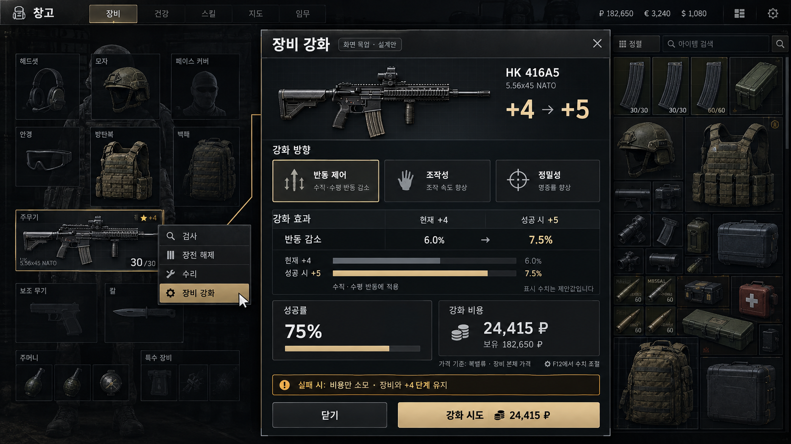
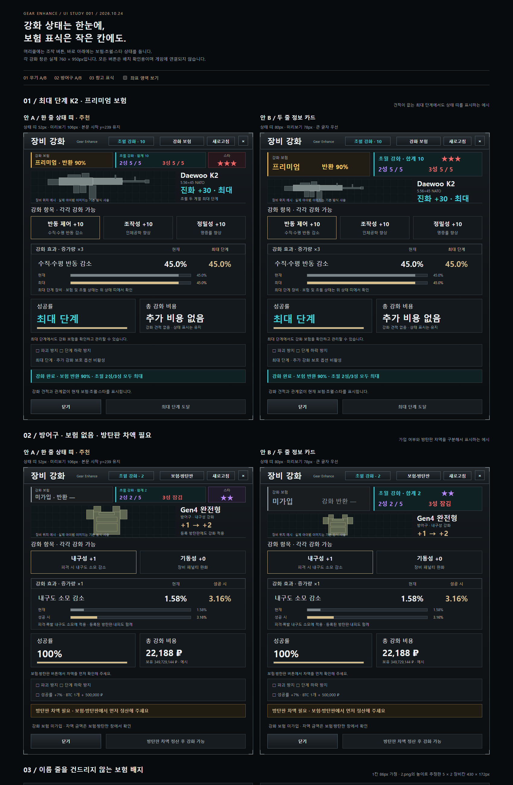
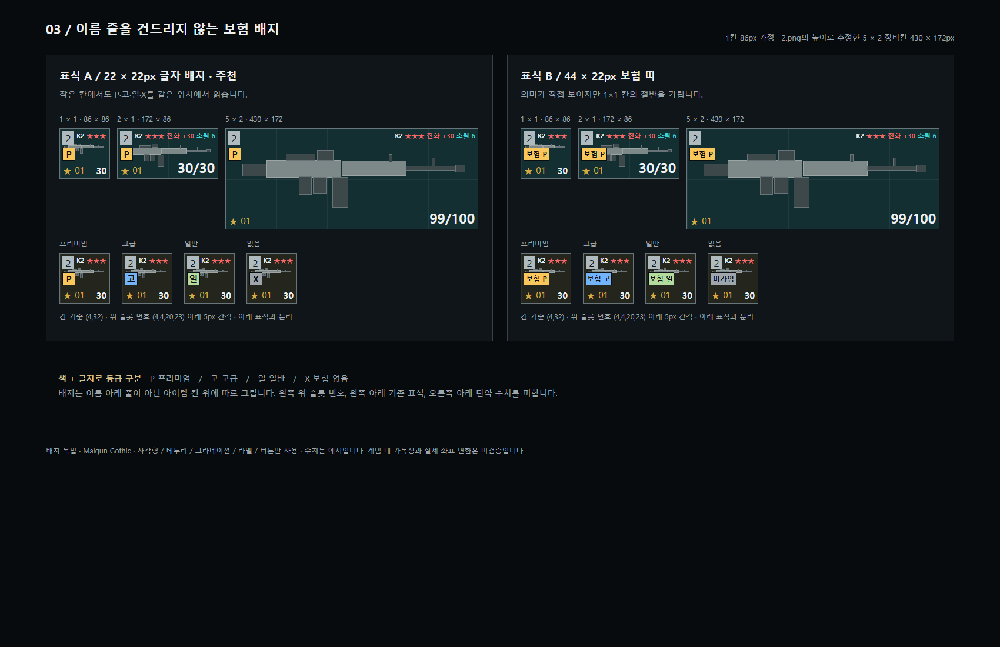

### IMPORTANT NOTICE / DISCLAIMER

- **Original Author:** R_F
- **Original Repository:** danyhappy564-cmyk/Gear_Enhance
- **Original Link:** https://github.com/danyhappy564-cmyk/Gear_Enhance
- **License:** MIT

1. **Reflection & Take-Downs:** I deeply reflect on the ECOT incident. As an AI-assisted "vibe coder," I will immediately delete files if the original authors ask.
2. **No Re-Distribution:** These ported builds are unverified, temporary fixes. Please do NOT re-upload or share them anywhere else.
3. **Do Not Pester Original Authors:** Never report bugs or pester original modders regarding issues from my unofficial ports.
4. **Full Credit & Respect:** I will always credit original creators on GitHub and prioritize their decisions above all else.
5. **Support Original Creators:** Instead of using my ports, please visit the original authors' Forge pages to leave kind words or tips.

---

## 변경 이력

- 2026-10-25 14:58 — 1.4.0 개발 중(2단계, 게임 확인 전): 강화 창을 손그림·목업대로 다시 만들었습니다. 왼쪽 세로 탭(일반 강화·★★성·★★★성·초월·???/✦ 신화·보험·도움말)과 오른쪽 장비 상태창(원본 / 강화 후 수치, 이번 시도로 바뀌는 값은 파란색, 줄마다 떨어지는 연출)을 넣고, 성공률 재료 3종을 2종까지 고르는 줄(개수 조절·최대 버튼), 즉시 강화 버튼(+5만 ₽), 진화 탭의 파괴 방지권 줄(사용·1장 구매), ??? 탭(50/50, 800만 + LEDX)과 신화 탭(방어구는 추가 부위 카드를 눌러 다시 뽑기), 보험 탭(등급 카드·돌아오는 중 남은 시간)을 넣었습니다. 파괴될 수 있는 시도는 확인 창으로 한 번 더 묻고(창을 닫을 때까지 끄기 가능, ??? 는 항상 물음), 결과는 팝업(파괴 조각·흔들림, 신화 달성 섬광·빛 고리·불꽃)으로 보여 줍니다. 창고에서는 진화 후 별만(★★·★★★), 신화는 분홍 ✦ 신화, 별 아래 줄에 초월·신화 단계를 쓰고 신화 칸 테두리가 반짝입니다. F12에 '연출 줄이기'·'창고 신화 칸 반짝임'·'파괴 확인 창'을 추가했습니다. 신화 효과의 게임 연결과 새 효과음은 다음 단계입니다.

전체 변경 이력 31개는 [`changelog/`](changelog/) 폴더에 10개씩 나눠 있습니다 (번호가 클수록 최신, 지금 마지막 파일: [`CHANGELOG-004.md`](changelog/CHANGELOG-004.md)).

# 장비 강화 — Gear Enhance 1.3.0

[](https://buymeacoffee.com/real_feels)

모드가 마음에 드셨다면 후원으로 응원해 주세요: https://buymeacoffee.com/real_feels

> **1.4.0 개발 중 (아직 게시 전, 게임 확인 전)** — 저장소의 코드는 1.4.0 작업본입니다. 설계: [`docs/DESIGN-1.4.0.md`](docs/DESIGN-1.4.0.md) · 한 장 요약: [`docs/DESIGN-1.4.0-SUMMARY.md`](docs/DESIGN-1.4.0-SUMMARY.md).
> - 들어간 것: 왼쪽 탭 화면(일반 강화 · ★★성 · ★★★성 · 초월 · ???/✦ 신화 · 보험 · 도움말) + 오른쪽 장비 상태창, 재료 성공률(독택·그래픽 카드·비트코인 2종), 즉시 강화, 방어구 +6 고위험, 진화 파괴 방지권, ???(50/50) → 신화 단계, 방어구 추가 보호 부위와 다시 뽑기, 강화 보험 99%·돌아오는 시간, 결과 팝업·확인 창·신화 연출, 창고 `✦ 신화`·초월 단계 줄·신화 칸 반짝임.
> - 아직 안 들어간 것: 신화 효과를 실제 게임에 연결(탄 데미지·관통, 받는 피해 감소, 추가 보호 부위), 새 효과음(??? · 신화 4종), 충전음 앞 무음 자른 편집본. 게임에서 화면이 어떻게 보이는지도 아직 확인하지 않았습니다.
> - 통신 버전 10: 클라이언트와 서버를 같이 바꿔야 합니다.

SPT **4.1.6**용 클라이언트·서버 모드입니다. **클라이언트·서버를 모두 1.3.0으로 교체**해야 합니다(통신 버전 9 — 한쪽만 바꾸면 강화 창이 "둘 다 업데이트" 안내를 띄우고 멈춥니다. 기록은 지워지지 않습니다. 1.2.0 이하로 되돌리면 초월 기록과 늘어난 최대 내구도 처리는 쓰이지 않습니다). 이전 강화/2차 진화 프로필 기록은 보존합니다. 창고의 무기·방어구를 우클릭하여 **장비 강화** 창을 열고(방탄판·내피는 방어구와 함께 강화되므로 메뉴가 없습니다), 강화할 항목·효과·확률·비용·실패 결과를 확인한 뒤 시도합니다.

**1.3.0**에서 ① ★★ 이상 장비에 **초월 강화**(2성·3성 트랙, 각 0~5단계)를 넣었습니다(아래 [초월 강화](#초월-강화-130)). ② 방탄판은 **칸 기준 자동 적용**입니다 — 값을 치른 방탄판 이하라면 새것·헌것 상관없이 끼우는 즉시 무료로 적용되고, 더 비싼 방탄판만 차액을 냅니다. ③ 강화 창 머리줄 아래 **상태 띠**(강화 보험 등급·반환 %, 초월 단계, 스타)와 창고·장비칸 **보험 배지**(P·고·일·X)를 넣고, 강화 보험 가입 때 게임 보험 소리가 납니다([화면 목업](#화면-목업-130)). ④ **은신처(사격장)에서도** 강화·초월 효과가 걸립니다. ⑤ 보험·방탄판 창 등록 버튼이 눌리지 않던 문제, 시세가 올라 모든 방탄판이 적용됐는데도 보험이 막히던 문제를 고쳤습니다.

**1.2.0**에서 ① **방어구에 끼운 방탄판·소프트 삽입물·바이저도 방어구 강화를 함께 받고 ★ 표식이 보이게** 했습니다(이 부품들은 따로 강화할 수 없습니다). 방어구 강화 비용에 끼운 방탄판 가격이 더해지고, 효과는 강화(또는 등록)할 때 끼워져 있던 방탄판만 받습니다. ② 상인 보험 대신 강화 창에서 드는 **강화 보험(일반 20% · 고급 55% · 프리미엄 90%)**을 넣었습니다. 레이드에서 잃으면 그 확률로 **강화된 상태 그대로** 우편으로 돌아오고, 보험료는 강화 가치에 따라 정해집니다. ③ 1.0.0 시절 보험 대기 중에 지워진 강화 기록을 반환 때 강화 결과 기록으로 되살리고 ④ 클라이언트·서버 버전이 섞이면 막습니다. **1.1.0**에서는 화면·F12 설정을 **한국어/영어**로 바꿀 수 있게 하고 **보험으로 돌려받은 장비, 플리마켓에서 안 팔려(또는 내려서) 우편으로 돌아온 장비의 강화·스타 기록이 이어지게** 했습니다. 1.0.0이 첫 정식 릴리즈입니다. 무기 3종(반동·조작성·정밀성)·방어구 2종(내구성·기동성)을 항목별로 강화하고, 전 항목 최대 후 ★★·★★★ 스타 진화(효과 2배·3배)까지 이어집니다. 무기 +6 시도부터는 실패 시 파괴·단계 하락 위험이 있고, 파괴 방지·하락 방지·비트코인 성공률 상승을 골라 쓸 수 있습니다. 강화된 장비는 창고에서 금색 ★ / 보라 ★★ / 빨간 ★★★ 표식으로 보입니다.

## 언어 (한국어 / English)

F12 맨 위 **`0. Language · 언어` → `Language · 언어`**에서 고릅니다.

| 값 | 동작 |
|---|---|
| `Auto` (기본) | 윈도우 표시 언어가 한국어면 한국어, 그 밖에는 영어 |
| `Korean` | 항상 한국어 |
| `English` | 항상 영어 |

- 강화 창·진화 창·결과 창·우클릭 메뉴(`Enhance gear`)·창고 표식(`★★ Evolved +30`)·서버 오류 안내가 바로 바뀝니다. 열려 있는 창의 안내 한 줄은 다음 안내부터 바뀝니다.
- F12 설정 이름·분류·설명도 바뀝니다. **F12 창을 닫았다 다시 열면** 적용됩니다(설정 관리자가 창을 열 때 글자를 다시 읽음).
- 설정 파일(`rf.gearenhance.cfg`)의 키는 예전 한국어 그대로라 언어를 바꿔도 값이 초기화되지 않습니다. `기준 가격`·`실패 처리` 같은 선택값은 원래도 영어(`Handbook`, `KeepItem` 등)입니다.
- LogOutput.log에 남는 진단 문구는 한국어 그대로입니다(서버 반환 우편 연결 로그만 한/영 같이 적음).
- 영어 문구는 칸 너비에 맞춰 짧게 썼고 글꼴 폭으로 대략 확인했지만, 실제 게임 화면에서 잘리는지는 아직 확인하지 않았습니다.

## 화면 구성



위 이미지는 실제 게임 캡처가 아닌 초기 설계 목업입니다. 현재 버전은 방향 선택 대신 각 항목을 따로 강화합니다. 전용 IMGUI 창에 실제 장비 아이콘, 항목 카드, 현재/성공 후 효과, 성공률·비용, 실패 안내를 표시합니다. 제목·설명은 중앙 정렬하며, 일반 강화 창은 760×950, 별도 진화 창은 760×910이고 화면 크기에 맞춰 축소합니다.

## 강화 효과

무기는 **반동 제어·조작성·정밀성 3종**, 방어구는 **내구성·기동성 2종**을 각각 강화하고 모두 함께 적용합니다. 예를 들어 반동 +10인 무기에서도 조작성 +0을 따로 올릴 수 있습니다.

| 장비 | 항목 | 일반 최대 +10 효과 | ★★ 효과 ×2 | ★★★ 효과 ×3 |
|---|---|---|---|---|
| 무기 | 반동 제어 | 수직·수평 반동15% 감소 | 30% 감소 | 45% 감소 |
| 무기 | 조작성 | 인체공학+10 | +20 | +30 (최종100 상한) |
| 무기 | 정밀성 | 탄·산탄 퍼짐10% 감소 | 20% 감소 | 30% 감소 |
| 방어구 | 내구성 | 내구도 소모30% 감소 | 60% 감소 | 80% 감소 (상한) |
| 방어구 | 기동성 | 장비 페널티20% 완화 | 40% 완화 | 60% 완화 |

**1차 스타 완료와 진화 완료는 별개입니다.** 무기3종/방어구2종을 모두 최대 단계까지 올리면 진화 조건만 충족합니다. 이때 일반 강화 창의 **스타 강화 진화 열기** 버튼으로 별도 창을 엽니다. 그곳에서 진화에 성공해야 기본 강화 효과의2배와 보라색 **`★★ 진화 +합계`** 표식이 붙습니다. 일반 최대 단계 달성만으로 자동 보너스는 받지 않습니다. ★★ 진화 성공 후 모든 항목이 최대이면 다시 진화 창을 열어 ★★★에 도전할 수 있습니다. 3차는 기본 효과의3배이며2차2배와 중첩해6배로 만들지 않습니다. 감소율은80%, 추가인체공학은50 상한을 적용합니다. 예를 들어3스타 방어구 내구성은90% 대신80% 감소입니다.

0.4.x의 강화 단계는 그대로 보존하지만 자동 완성 보너스는 별도 진화 성공으로 대체합니다. 진화는 별도 기록으로 저장하고 재접속해도 중복 누적하지 않습니다.

초반은 같은 증가량, 절반 이후는 단계당 증가량이 1→4배가 되는 곡선입니다. 전체 증가량을 최대 단계에 맞춰 배분하므로 +10의 기본 효과는 위 표와 같습니다. 반동 +1~+5는 각각 약 0.79%p씩, 마지막 +9→+10은 약 3.16%p 증가합니다. **기존 단계는 유지하지만 중간 단계 효과도 새 곡선으로 다시 계산**하므로 이전 버전과 달라집니다.

| 시도 단계 | 기본 성공률 | 해당 단계 증가 배율 | 반동 감소 누계(진화 보너스 전) |
|---|---|---|---|
| +1 | 75% | 1배 | 0.79% |
| +2 | 70% | 1배 | 1.58% |
| +3 | 65% | 1배 | 2.37% |
| +4 | 60% | 1배 | 3.16% |
| +5 | 55% | 1배 | 3.95% |
| +6 | 50% | 1.6배 | 5.21% |
| +7 | 45% | 2.2배 | 6.95% |
| +8 | 40% | 2.8배 | 9.16% |
| +9 | 35% | 3.4배 | 11.84% |
| +10 | 30% | 4배 | 15% |

최대 단계를 바꾸면 곡선과 절반 기준도 함께 바뀝니다. 최대 효과 기준값은 `단계 기본값 × 최대 단계`와 효과 상한 중 작은 값이고, 성공한 진화 보너스는 그 뒤에 적용합니다. 최종 감소율은 80%, 인체공학 추가는 50을 넘지 않습니다.

효과는 해당 아이템 ID에만 적용합니다. 원본 템플릿·기존 수리 버프는 덮어쓰지 않습니다. 반동은 부착물 배율을 반영한 무기 성분에 적용하고 별도 카메라 반동은 대상이 아닙니다. 정밀성은 탄 퍼짐만, 내구성은 실제 내구도 소모만, 기동성은 음수 장비 페널티만 바꿉니다.

### 방어구에 끼운 방탄판 (1.2.0)

- **방어구에 끼운 방탄판·소프트 삽입물·바이저**(방어구의 슬롯에 들어 있는 부품)는 그 방어구의 내구성·기동성 강화를 함께 받고, 창고·검사 화면에서도 방어구와 같은 ★ 표식이 붙습니다.
- **비용**: 방어구의 강화·진화 비용은 `본체 + 지금 끼운 부품` 가격으로 계산합니다(무기는 지금처럼 본체만). 가격 기준 줄에 `본체+끼운 방탄판`이 표시됩니다.
- **적용(칸 기준)**: 방어구는 방탄판 한 장 한 장이 아니라 **지금까지 값을 치른 방탄판 값**을 기억합니다. 싼 방탄판으로 싸게 강화한 뒤 비싼 방탄판으로 바꿔 끼우는 것만 막습니다.
  - **1.3.0부터 자동 적용**: 강화된 방어구에 방탄판을 끼우면, 값을 치른 방탄판과 **같거나 더 싸면 새것·헌것 상관없이 바로 무료 적용**되어 그 방어구 단계를 받습니다. 강화 창·보험·방탄판 창을 열 때도 한 번 더 맞춥니다. 레이드 중에 끼운 것은 레이드가 끝나면 적용됩니다. F12 `1. 기본 → 방탄판 자동 등록`(기본 켜짐)으로 끌 수 있습니다.
  - **더 비싼 방탄판**은 자동 적용되지 않고 "차액을 내야 강화 효과를 받습니다" 안내가 뜹니다. `보험·방탄판` 창의 `차액 내고 적용` 버튼으로 내거나, 다음 강화 비용에 붙여 냅니다. 한 번 내면 그 값까지는 자유롭게 갈아끼웁니다.
- **차액**: 지금 끼운 부품이 지금까지 값을 치른 부품보다 비싸면 그 가격 차이만큼을 `방탄판 차액`으로 한 번 냅니다. **1.3.0부터는 이미 올린 단계마다 평균 시도 횟수(1 ÷ 그 단계 성공률)만큼** 받습니다(★★ 진화분·초월분 포함, 초월은 천장까지 계산). 처음부터 그 방탄판으로 강화한 사람이 평균적으로 낸 돈과 같아지게 하려는 것입니다. 예: 5만 → 30만 방탄판, +10이면 약 204만(1.2.0은 약 83만), ★★분 250만(1.2.0은 75만). 개발자 옵션 `방탄판 차액 배율`(기본 100%)로 조절합니다. 같거나 싼 방탄판 등록은 무료입니다.
- **2성 초월 최대 내구도(1.3.0)**: 적용된 방탄판도 늘어난 최대 내구도를 받습니다(상인에게 산 새 방탄판 포함). 빼서 창고·가방에 두는 동안은 숫자만 남고 효과는 없습니다(잠깐 뺐다 끼워도 내구도가 잘리지 않음). **다른 방어구에 끼우는 순간**(레이드 중이면 레이드가 끝날 때) 늘어난 만큼이 빠지고, 넘친 현재 내구도는 잘립니다. 원래 방어구에 다시 끼우면 최대치만 다시 오릅니다(공짜 수리 방지).
- **방탄판·내피·헬멧 부착 방호구(바이저 등)는 따로 강화할 수 없습니다.** 우클릭 메뉴에 `장비 강화`가 뜨지 않고, 서버도 거절합니다. 방어구에 끼운 채 방어구를 강화(또는 등록)하면 방어구 단계를 함께 받습니다. 그래서 "1강 방어구에 4강 방탄판" 같은 엇갈린 단계가 생기지 않습니다.
- 1.2.0 전에 따로 강화해 둔 방탄판은 **기록은 지우지 않지만 효과는 없습니다.** 더 강화할 수 없고, 방어구에 끼우면 그 방어구의 단계만 씁니다(방탄판 자기 단계 무시, 자기 ★ 표식도 안 보임).
- 빼서 조끼 주머니·가방에 넣어 둔 방탄판은 적용되지 않습니다. 무기 부착물은 무기 강화를 상속하지 않습니다.
- 1.2.0 이전에 강화한 방어구는 업데이트 후 처음 볼 때 끼워져 있던 부품을 무료로 등록합니다.

### 강화 보험 (1.2.0)

강화 창 위쪽 **`보험·방탄판`** 버튼(무기는 `강화 보험`)으로 엽니다. 상인 보험과 별개입니다.

- **우클릭 메뉴는 늘어나지 않습니다.** 게임 우클릭 메뉴에는 지금처럼 `장비 강화` 한 줄만 붙고, 강화 보험·방탄판 등록은 강화 창 안에서 합니다. 창 크기(760×950)도 그대로이고, 보험 창은 강화 창 위에 겹쳐 뜹니다.
- 강화 창 머리줄에 지금 가입한 강화 보험이 등급 색으로 보입니다(`강화 보험 고급 55%` / `강화 보험 없음`).
- 1.3.0부터 강화 창 머리줄 아래 상태 띠에 보험 등급·반환 %가 항상 보이고, 창고·장비칸에는 칸 왼쪽 색 배지(P·고·일·X)로 보입니다. 가입하면 게임의 보험 가입 소리가 납니다.
- 글씨 색: 일반 = 연두, 고급 = 파랑, 프리미엄 = 주황빛 금색. 초록은 좋은 결과(강화된 채 반환·모두 등록됨), 주황은 주의(미등록 방탄판·보험 소모·방탄판 차액), 빨강은 손실(상인 보험은 +0·강화 소멸)입니다.

| 등급 | 레이드에서 잃었을 때 강화된 채 돌아올 확률 | 기본 보험료(강화 가치 대비) |
|---|---|---|
| 일반 | 20% | 5% |
| 고급 | 55% | 15% |
| 프리미엄 | 90% | 30% |

- **강화 가치** = 지금 단계·스타까지 강화하는 데 드는 기본 비용의 합(방어구는 등록한 방탄판 가격 포함, ★★ 진화비·★★★ 400만 포함). 단계가 높을수록 보험료가 오릅니다. 최소 비용 이상, 1회 최대 1억 루블.
- 레이드가 끝났을 때 강화 장비가 없어졌으면(사망·두고 나옴) 등급 확률로 판정합니다. 성공하면 **장비와 슬롯 부품(부착물·탄창·방탄판)**이 강화·스타·방탄판 등록 그대로 **바로 우편**으로 옵니다(탄약·주머니 안 물건은 제외). 이때 같은 장비의 상인 보험 반환은 빠져 두 개가 되지 않습니다.
- 실패했거나 강화 보험이 없으면 **강화는 사라집니다.** 상인 보험을 들어 두었다면 상인이 평소처럼 돌려주지만 +0 일반 장비입니다. **상인 보험만으로는 강화가 돌아오지 않습니다.**
- 보험은 한 번 잃으면 소모됩니다. 강화에 성공하거나 더 비싼 방탄판을 등록하면 강화 가치가 바뀌어 보험이 풀립니다(다시 가입). 같은 등급 이상이 들어 있으면 다시 살 수 없고, 더 높은 등급으로는 바꿀 수 있습니다(새 등급 보험료 전액).
- 1.2.0 설치 전에 이미 잃어서 상인 보험 대기 중인 장비는 예전(1.1.0) 방식대로 강화를 유지한 채 돌아옵니다.
- F12 개발자 옵션 `12. 강화 보험`(비밀번호로 잠김)에서 등급별 확률·보험료를 바꿀 수 있습니다. 확률은 가입할 때의 값으로 고정됩니다.

## 고위험 강화

**선택한 무기 항목의 다음 단계가 +6 이상인 시도**에 고위험 규칙을 적용합니다(+5→+6부터). 다른 항목이 +0이어도 적용하며, +4→+5까지는 기본 설정에서 비용만 소모합니다. 최대 단계를 바꿔도 위험 시작은 +6 시도로 고정합니다.

- 성공: 선택 항목 +1.
- 실패 중 25%: 본체·부착물·탄창·탄약 파괴, 보험과 강화 기록 제거.
- 실패 중 나머지 75%: 선택 항목만 -1, 다른 항목·장비 내구도 유지.
- 하락 후 +5가 되어도 +5→+6 재시도에는 고위험과 보호 옵션이 적용됩니다. +5→+4로 하락하면 다음 +4→+5 시도는 일반 구간입니다.

파괴 확률은 **실패한 경우 안에서의 비율**입니다. 반동 +5에서 +6을 시도하면 다른 두 항목과 무관하게 성공50%, 파괴12.5%, 단계 하락37.5%입니다. 창에는 실패 중 파괴 비율과 이번 시도 전체의 파괴 확률을 함께 보여줍니다. 파괴 가능성이 있으면 기존 확인란을 체크해야 합니다. 항상 성공 옵션은 고위험 구간도 100% 성공입니다.

방어구는 일반 실패 설정을 따릅니다. F12에서 무기 고위험 강화를 끄거나 실패 중 파괴 확률을 0%(하락만)~100%(파괴만)로 조절할 수 있습니다.

## 강화 보호 옵션

강화 창의 체크 칸에서 **파괴 방지**와 **단계 하락 방지**를 각각 선택할 수 있습니다. 선택한 항목의 다음 단계가 +6 이상이고 해당 손실 가능성이 있어야 체크할 수 있습니다. +5→+6 재시도도 두 방지를 선택할 수 있습니다. +4→+5 이하에서는 선택과 보호비 부과를 막습니다.

- 파괴 방지: 파괴 판정이 나와도 장비·부착물·모든 강화 단계를 유지합니다. 하락 판정은 막지 않습니다.
- 단계 하락 방지: 하락 판정 때 단계를 유지합니다. 파괴 판정은 막지 않습니다.
- 둘 다 선택: 파괴/하락이 발생하지 않으며 실패 시 기본 강화비와 보호비만 소모합니다. 성공률 자체는 올라가지 않습니다.

보호는 해당 판정만 취소하며 다른 손실로 바꾸거나 성공으로 재추첨하지 않습니다. 보호비는 성공·실패·보호 발동 여부와 관계없이 매 시도 차감합니다. 100% 성공·일반 비용 소모 실패·+0 하락처럼 보호할 손실이 없으면 해당 체크 칸을 비활성화하고 비용도 받지 않습니다. 내구도 0 옵션을 막는 보호는 아닙니다.

추가 비용은 각각 `기본 강화비 × 시도 단계² × 보호 계수`를 올림합니다. 기본 계수는 파괴50%, 하락35%이며 F12에서 바꿀 수 있습니다. 두 보호비는 기본 비용을 기준으로 독립 계산하고 더합니다.

| 시도 | 기본 비용 | 파괴 방지 추가 | 하락 방지 추가 | 둘 다 선택한 총액 |
|---|---|---|---|---|
| +5→+6 | 30,518 ₽ | 549,324 ₽ | 384,527 ₽ | 964,369 ₽ |
| +10 | 74,506 ₽ | 3,725,300 ₽ | 2,607,710 ₽ | 6,407,516 ₽ |

위 예시는 본체 기준가10만·기본 비용 설정·무기 고위험 조건일 때입니다. 창에 기본/보호/총액과 보호 후 남는 위험을 표시하며 체크를 바꾸면 서버 견적을 다시 받습니다. 총액1억 루블을 넘으면 차감 전에 거절합니다. 파괴 방지를 켜서 실제 파괴 가능성이 사라지면 별도 파괴 확인란은 필요 없습니다.

## 스타 강화 진화 — ★ → ★★ → ★★★

**1차 스타의 모든 항목이 최대 단계인 장비만** 별도 진화 창을 열고 시도할 수 있습니다. 기본 +10이면 무기3종 각각+10 또는 방어구2종 각각+10이 필요하며 서버에서도 다시 확인합니다.

- 기본 성공률30%, 비용은 **최소200만 루블과 본체 기준가의3배 중 큰 값**입니다. 본체10만이면200만, 본체100만이면300만 루블입니다. 일반 최소비용을200만보다 높게 지정하면 그 설정도 반영합니다.
- 성공: 기존 항목 단계는 유지하고 강화 효과를2배로 올리고, 보라색 `★★ 진화` 표식을 받습니다.
- 실패: 장비 본체·부착물·탄창·탄약과 보험·강화 기록을 모두 제거합니다.
- **진화에는 파괴/하락 방지를 사용할 수 없습니다.** 실패 가능성이 있으면 별도 파괴 확인란이 필요합니다.
- 2차 성공 장비는 3차에 도전할 수 있고, 3차 성공 후에는 더 진화할 수 없습니다. 성공한 진화 기록은 일반 항목 단계와 별도로 유지됩니다.

### 3차 스타 진화 — ★★ → ★★★

- **2차 스타에 성공하고 모든 항목이 현재 최대 단계인 장비만** 도전할 수 있습니다. 1차에서3차로 바로 건너뛰는 요청은 서버가 거절합니다.
- 기본 성공률 **10%**, 기본 비용 **4,000,000루블 고정**입니다. 본체 가격·일반 최소비용·가격 배수로 바뀌지 않습니다.
- 성공: 기본 강화 효과 대비 **효과3배**, 빨간색 **`★★★ 진화 +합계`** 표식. 항목별 단계는 그대로 유지합니다.
- 실패: 장비·부착물·탄창·탄약·보험·강화/진화 기록 파괴. **파괴 방지·단계 하락 방지 불가**입니다.
- 충전음(심장박동 포함)·성공음은2차 스타와 동일하고, 실패는 파괴음입니다.
- 기존2차 스타 장비는 보라색/2배를 적용하며 자동으로3차가 되지 않습니다. 3차는 재접속 후에도 저장되며 추가로 중첩하지 않습니다.

### 성공률 상승 체크

| 강화 종류 | 비트코인 | 고정 추가 루블 | 성공률 상승 | 기본 확률 → 체크 시 |
|---|---|---|---|---|
| 일반 항목 강화 | 1개 | 500,000 ₽ | +7%p | +1 시도75% → 82% |
| 2차 스타 | 3개 | 1,000,000 ₽ | +10%p | 30% → 40% |
| 3차 스타 | 10개 | 3,000,000 ₽ | +10%p | 10% → 20% |

기본 강화비와 선택한 일반 보호비에 추가합니다. **3차 스타 상승 체크 시 총7,000,000루블+비트코인10개**입니다. 위 추가비/비트코인/상승폭은 단계·아이템 가격·F12 수치에 영향받지 않습니다. 비트코인은 창고 안에서 사용 가능한 것을 쓰고 **인레이드 여부는 무관**합니다. 잠긴 비트코인과 장착 중/창고 밖 재료는 사용하지 않습니다.

성공·실패·파괴와 관계없이 실제 시도 때 루블과 비트코인을 한 번 소모합니다. 체크/견적 조회만으로 소모하지 않으며 해제하면 추가비도 제외합니다. 견적 후 재료가 사라지면 차감 전에 다시 거절합니다. 성공률은100%가 상한이며 이미100%인 견적은 상승 체크/추가비를 적용하지 않습니다. 일반 보호비는 상승 추가비를 제외한 원래 강화비로 계산합니다. 상승 옵션은 실패 방지 기능이 아니며 진화 실패의 파괴를 막지 않습니다.

진화 창은 현재 효과와 진화 후 효과를 모든 항목에 대해 비교합니다. 충전 중에는 기존 강화음과 빨라진 심장박동 구간을 섞은 전용 소리를 쓰고, 성공 시 **스타 2 달성 시.mp3**를 재생합니다. 실패 시 파괴음을 사용합니다. 2차 확률·가격비율·보너스와3차 확률·총보너스는 개발자 옵션에서만 표시합니다. 3차 기본400만과 상승 재료비는 고정입니다. 개발자용 항상 성공을 켠 경우 진화도100% 성공입니다.

## 초월 강화 (1.3.0)

★★ 이상 장비는 강화 창 머리줄에 **`초월 강화 · N`** 버튼이 생깁니다(N = 두 트랙 단계 합 0~10). 초월은 기존 강화 위의 별도 트랙 2개이고, 스타 배율(×2·×3)을 받지 않습니다.

| 트랙 | 총기 | 방어구 |
|---|---|---|
| **2성 초월** (★★ 이상) | 수평 반동(뒤로 차는 힘·좌우 튐) 단계당 -6%, 5단계 -30% (반동 제어와 합쳐 최대 80%) | 최대 내구도 단계당 +6%, 5단계 +30% (적용된 방탄판·내피 포함) |
| **3성 초월** (★★★) | 연사 가능 총: 발사속도 단계당 `+50rpm`과 `원래의 6%` 중 작은 값 (5단계 약 +30%) · 반자동·볼트액션: 고장 -10%·과열 -8%/단계 | 둔탁상 단계당 -5%, 3단계 방어등급 +1, 5단계 +2 (최대 6클, 이미 6클이면 둔탁상 추가 감소) |

- **성공률**: 2성 60/50/40/30/20%, 3성 40/30/20/15/10% (→1~→5). 실패할 때마다 다음 성공률 +5%p(2성)/+3%p(3성), 최대 +30%p(천장). 비트코인 성공률 상승도 씁니다.
- **실패**: 파괴 없음. →1~→3은 비용·재료만, →4·→5는 1단계 하락(`단계 하락 방지`로 막기 가능, 기본 비용만큼 추가).
- **비용**: 루블(최소 2성 100만·3성 300만, 단계마다 ×1.5) + 재료(무기 부품·화약·아라미드·립스탑·군용 회로 기판·Virtex·그래픽 카드·LEDX). 초월 창에서 보유/필요가 초록·빨강으로 보입니다.
- **표식**: 창고 이름 옆 청록색 `초월 N`, 칸 배경 청록.
- 2성 초월로 늘어난 최대 내구도는 상인·플리 판매가에 반영되지 않고, 방탄판을 빼서 다른 방어구에 끼우면 빠집니다(빼서 창고에 두기만 하면 유지).
- 확률·천장·비용·재료·효과 크기는 F12 개발자 옵션 `13. 초월 강화`(비밀번호 잠금)에서 바꿉니다.
- **은신처(사격장)**: 은신처는 장비를 새 ID로 복사해 쓰므로, 같은 칸의 원본 장비 기록을 따라가게 했습니다(템플릿이 같을 때만, 레이드에서는 쓰지 않음).

## 화면 목업 (1.3.0)

강화 창 상태 띠와 창고 보험 배지는 아래 목업에서 **A안**(왼쪽)을 골라 그대로 옮겼습니다. 숫자는 예시입니다.





## 사용 흐름과 진행 연출

1. 장착 해제한 장비를 창고에 넣고 내부 보관칸을 비웁니다.
2. 우클릭 → 장비 강화 → 강화할 항목을 선택합니다. 항목 선택에는 비용이 없습니다.
3. 단계·효과·성공률·비용·손실을 확인하고 필요한 보호·성공률 상승 옵션을 체크합니다. 보호 후에도 파괴 가능성이 남으면 파괴 안내를 체크합니다.
4. 강화 시도를 누르면 **강화 중 음원 길이(약 4.412초) 동안 “강화 진행 중…”과 채워지는 게이지**가 표시된 뒤 서버에 판정을 요청합니다.
5. 서버 영수증 후 중앙의 큰 확인창에서 성공·실패·하락·파괴와 루블/비트코인 비용을 확인합니다. 확인을 눌러야 다음 조작이 가능합니다. 서버 응답이 늦으면 게이지가 찬 상태로 기다립니다.

진행 중에는 중복 강화·항목 변경·보호 변경·새로고침을 막습니다. 설정 변경이나 창고 이탈은 전송 전 시도를 취소합니다. 게임 스레드를 멈춰 기다리지 않습니다. 견적은 60초 유효하며 만료되면 다시 불러옵니다. 결과 미확정 시에는 자동으로 재시도하지 않습니다.

성공·진화 성공·실패·하락·파괴는 중앙의 큰 제목과 결과 설명·소모 비용으로 표시합니다. 확인 전에는 뒤쪽 조작을 막습니다. 보호 발동은 “강화 실패”와 보호 발동 안내를 함께 표시하여 성공과 혼동하지 않게 합니다.

일반 강화는 금색 배경과 `★ +전체 단계 합계`, 진화 성공 장비만 보라색 배경과 `★★ 진화 +합계`, 3차 성공은 빨간색 배경과 `★★★ 진화 +합계` 표식을 씁니다. 미확인·오류·충돌·장전 표시가 우선하며 표식 오류가 장비 생성을 중단하지 않도록 합니다. 일반 성공은 금색, 2차 성공은 보라색, 3차 성공과 실패는 붉은색으로 미리보기가 잠깐 빛납니다. 파괴는 **강화 창 안의 장비 이미지 9개 조각이 흩어지는 연출**입니다. 게임 공간의 폭발 효과는 생성하지 않습니다.

사용자 제공 음원은 다음처럼 연결합니다.

| 제공 파일 | 재생 시점 |
|---|---|
| 강화중소리.mp3 | 일반 강화 시작, 약 4.412초 게이지와 동기화 |
| 강화 성공할때.mp3 | 일반 강화 성공 |
| 강화실패.mp3 | 일반 실패·단계 하락 |
| 파괴될때.mp3 | 서버가 파괴 결과를 확정했을 때 |
| 스타 2 달성 시.mp3 | 스타 강화 진화 성공 |
| heart-beat-speeds-up.mp3 | 마지막 약4.412초를 잘라 기존 강화음과 혼합, 진화 충전 전용 |

일반 강화/결과 음원5개는 PCM16으로만 변환하고, 심장박동만 마지막 구간을 잘라 기존 강화음과 혼합했습니다. 재생용 음원6개는 DLL에 포함하므로 별도 파일·코덱·FFmpeg 설치가 필요 없습니다. 시작할 때 PCM 데이터를 보관하고 실제 게임 UI 오디오가 준비된 뒤 Unity 음원을 만듭니다. 게임이 오디오 장치를 다시 설정하면 다음 재생 때 다시 준비합니다.

전용 소스가 요청0.25초 후에도 재생 중이 아니면 **같은 사용자 음원**을 게임 UI 재생 경로로 전환합니다. 충전음은 이미 지난 부분을 건너뛰어 기존 게이지의 남은 시간에 맞추며, 결과음은 처음부터 재생합니다. 이 경로도 게임 마스터/인터페이스 음량과 F12 전용 음량(기본70%)을 따릅니다. 다른 UI 소스를 멈추거나 볼륨·클립을 바꾸지 않습니다. 음원 생성이나 연결 자체가 실패하면 게임 기본음으로 대체합니다.

F12에서 **자세한 로그 남기기**를 체크한 동안만 음원 설정·재생/대체 경로·소스/클립 상태, UI CPU, 초월 발사속도 실측(연사 12발마다 실제 rpm), 은신처 장비 연결 진단을 기록합니다. 기본 OFF이며 즉시 전환할 수 있고 견적/진행 중 강화에는 영향을 주지 않습니다. 실제 오류·경고와 시작 버전 안내는 그대로 기록합니다. 제공0.6.2 로그에서는 설정 ON·준비 성공에도 재생False/샘플0을 확인했습니다. 0.6.3 이후 사용자가 기존 동작이 잘 된다고 보고했으며 구체적인 외부 차단 원인은 미확정입니다. 이번 버전의 새 클릭음·3차 화면은 재검증이 필요합니다.

버튼·항목 선택은 게임의 ButtonClick, 체크 변경은 MenuCheckBox, 창 여닫기는 MenuInspectorWindowOpen/Close를 실제 입력 때 한 번 재생합니다. 비활성 컨트롤과 단순 다시 그리기에는 클릭음이 나지 않습니다. 클릭음은 강화 충전/결과음을 멈추지 않으며 F12 강화 효과음 설정과 게임 UI 음량을 따릅니다.

강화 중 소리는 Unity 오디오 재생 시계에 예약하고 게이지도 같은 시계를 사용합니다. 결과 연출과 결과음은 서버 영수증 확인 뒤에만 발생합니다. 서버가 늦으면 충전음이 끝난 뒤 가득 찬 게이지로 기다립니다. 전용 소리 연결 실패 시 게임 기본음으로 대체하고 강화 결과에는 영향을 주지 않습니다. 창을 닫거나 플러그인이 종료되면 자체 소리를 정리합니다. 아이콘·배경·스타일·타입 조회는 캐시하며 조각 연출에 새 텍스처나 GUI 좌표 회전을 사용하지 않습니다.

음원은 사용자 제공 자료이고 코드의 MIT 라이선스와 별개입니다. 원본 파일명·해시·변환 정보는 [음원 기록](assets/audio/README.md)에 있습니다.

자세한 로그를 켜고 창을 닫으면 LogOutput.log에 Repaint CPU 평균·최대 시간을 한 번 기록합니다. 게임 전체 FPS나 GPU 시간은 아닙니다.

100% 성공도 비용을 소모합니다. 장착 중·레이드·상인 판매품·타인 아이템은 강화할 수 없습니다. 0.2.x의 단계는 기존 항목으로 무료 이전하고 다른 항목은 +0부터 시작합니다. 0.1의 단계만 남은 기록은 첫 항목에 기존 단계를 무료·100%로 복원합니다.

## F12 설정

0.7.1 최초 실행 시 이전 기본 효과20%/35%만100%/200%로 한 번 이전합니다. 이는2배/3배 효과이며, 다른 개발자 사용자 지정값은 보존합니다. 이미 스타를 달성한 장비에도 적용하므로 재강화하지 않아도 됩니다. F12 개발자 추가효과 범위는0~300%(효과1~4배)입니다.

0.6.2 이후 최초 실행 시 이전 기본 진화 성공률50%만30%로 한 번 이전합니다. 다른 값으로 변경한 개발자 확률은 유지합니다. 이 설정 이전 상태는 F12에서 숨깁니다.

일반 F12 목록에는 **강화 메뉴 사용, 방탄판 자동 등록(1.3.0), 효과음 ON/OFF, 전용 음원 사용, 전용 음량, 자세한 로그 남기기(기본 OFF)**만 표시합니다. 확률·성공 보장·최대 단계·가격·실패 처리·능력치·보호비·진화·보험 밸런스는 **99. 개발자 옵션**에 묶고 기본으로 숨깁니다.

**개발자 옵션은 비밀번호로 잠겨 있습니다(1.2.0).** `99. 개발자 옵션 → 개발자 옵션 비밀번호` 칸(입력하면 `*`로 가려지고 옆에 `잠김`/`열림` 표시)에 제작자가 정한 비밀번호를 넣고 F12 창을 닫았다 다시 열면 아래 설정이 나타납니다. 비밀번호는 공개하지 않으며, 코드에는 비밀번호 원문이 아니라 해시(되돌릴 수 없는 암호값)만 들어 있습니다.

- **잠겨 있으면 숨길 뿐 아니라 기본값으로 강화합니다.** 예전에 `항상 성공` 등을 바꿔 둔 값이나 설정 파일을 직접 고친 값도 적용되지 않습니다. 저장값은 지우지 않아서, 다시 열면 그 값으로 돌아갑니다.
- 맞는 비밀번호는 설정 파일에 남아 그 PC에서는 다시 시작해도 열린 상태가 유지됩니다. 칸을 비우면 다시 잠깁니다.
- 1.1.0 이하의 `개발자 옵션 표시` 체크는 더 이상 쓰지 않습니다(설정 파일에 남아 있어도 무시).
- 공개 저장소라 코드를 고쳐 다시 빌드하면 풀 수 있습니다. F12에서 쉽게 밸런스를 바꾸는 것을 막는 장치입니다.

설정 파일은 `BepInEx/config/rf.gearenhance.cfg`입니다.

아래는 개발자 옵션을 포함한 기본값입니다.

| 설정 | 기본값 |
|---|---|
| 시작 성공률 / 단계별 감소 / 항상 성공 | 75% / 5%p / OFF |
| 항목별 최대 단계 | +10 |
| 기준 가격 | 북밸류(플리 기준가 선택 가능) |
| 비용 비율 / 단계별 비용 배수 / 최소 비용 | 10% / 1.25배 / 1,000 루블 |
| 일반 구간 실패 처리 | 비용만 소모 |
| 무기 고위험 강화 / 실패 중 파괴 확률 | ON / 25% (나머지는 선택 항목 -1) |
| 2차 / 3차 효과 배율 | ×2 / ×3 (개발자 추가효과 설정은+100% / +200%) |
| 스타 강화 진화 성공률 / 본체 가격 대비 비용 | 30% / 300%, 최소2,000,000 ₽ |
| 3차 스타 기본 성공률 / 비용 | 10% / 4,000,000 ₽ 고정 |
| 강화 효과음 / 전용 음원 / 전용 음량 | ON / ON / 70% |
| 파괴 방지 / 단계 하락 방지 비용 계수 | 50% / 35% (시도 단계²를 추가로 곱함) |
| 효과별 기본값 / 상한 | 반동 1.5/15, 인체공학 1/10, 정밀성 1/10, 내구성 3/30, 기동성 2/20 |
| 강화 보험 반환 확률 일반/고급/프리미엄 | 20% / 55% / 90% |
| 강화 보험료(강화 가치 대비) 일반/고급/프리미엄 | 5% / 15% / 30% |
| 방탄판 자동 등록 (일반 목록, 1.3.0) | ON |
| 방탄판 차액 배율 (1.3.0) | 100% (평균 시도 횟수 기준) |

설정 변경은 기존 견적을 무효화하며 효과 설정은 기존 장비에도 적용됩니다. 최대 단계 변경은 효과 곡선·1차 최대 달성 판정·고위험 시작점에도 반영됩니다.

비용은 `최대(최소 비용, 본체 기준가 × 비용 비율 × 배수^선택 항목 현재 단계)`를 올림합니다. 1회 상한은 1억 루블입니다. 무기는 부착물 가격을 제외하고, 방어구는 슬롯에 끼운 방탄판·삽입물·바이저 가격을 더합니다(1.2.0). 기준가 10만이면 +0→+1은 1만, +1→+2는 12,500 루블입니다. 플리 가격은 SPT 템플릿별 기준가이며 없으면 북밸류로 대체합니다.

일반 실패 옵션은 KeepItem(비용만), ZeroDurability(현재 내구도 0·최대 내구도 유지), Destroy(본체·부착물·탄약 파괴), Downgrade(선택 항목 -1, 최저 +0)입니다. 무기 고위험 구간에서는 일반 옵션보다 파괴/하락 규칙이 우선합니다. 고위험 기능을 끄면 일반 옵션을 모든 단계에 적용합니다.

## 저장과 동기화

항목별 단계와 최근 100회 결과는 SPT 프로필 최상위 `rfGearEnhance.Tracks`에 아이템 ID별로 보관하며 일반 SPT 저장 주기를 사용합니다. 2차 성공은 `rfGearEnhance.EvolvedItems`, 3차 성공은 `rfGearEnhance.ThirdStarItems`에 별도 저장하며 각 항목 단계와 최근 결과에 진화 상태를 함께 동기화합니다. 진화 성공 전에는 보너스를 적용하지 않고 성공 후에도 중복 누적하지 않습니다. 프로필 로드와 강화 후 서버 기록을 동기화하고, 기록 동기화가 실패하면 새 견적을 막습니다.

### 보험·플리마켓으로 돌아온 장비 (1.1.0, 1.2.0 보강)

> **1.2.0부터 레이드에서 잃은 강화 장비는 [강화 보험](#강화-보험-120)이 정합니다.** 상인 보험으로 돌아오면 +0입니다. 아래 기록 연결은 플리마켓 반환, 강화 보험 반환, 1.2.0 설치 전에 이미 잃어 상인 보험 대기 중이던 장비에 씁니다.

SPT는 우편으로 아이템을 보낼 때 첨부물을 복제하면서 **아이템 ID를 전부 새로 붙입니다**(`MailSendService.SendMessageToPlayer` → 첨부 복제 + `ReplaceIDs`). 1.0.0까지는 강화 기록이 옛 ID에 묶여 있어서 보험 반환·플리 미판매 반환 장비가 강화 안 된 장비로 돌아왔습니다. 1.1.0은 다음처럼 이어 줍니다.

1. 레이드에서 잃은 보험 장비(보험 대기 목록), 플리에 올린 장비(내 판매 목록), 아직 안 받은 우편 첨부물의 기록은 **창고에 없어도 지우지 않습니다.** 위 세 곳 어디에도 없는 장비(팔림·보험 없이 잃음·우편 기한 만료)의 기록만 예전처럼 정리합니다.
2. 서버가 우편을 보내는 순간(SPT 기본 우편 함수에 거는 서버 패치) 첨부물의 옛 ID → 새 ID 짝을 받아, 기록이 있는 장비의 **항목별 단계·★★/★★★ 진화를 새 ID로 옮깁니다.** 순서·템플릿이 하나라도 안 맞으면 아무것도 옮기지 않고, 지금 창고에 그대로 있는 장비의 복사본 우편(다른 모드의 선물 등)은 옮기지 않아 기록이 둘로 늘지 않습니다.
3. 클라이언트는 처음 보는 아이템 칸이 창고·우편 화면에 나타나면(레이드 밖, 강화 창이 닫혀 있을 때, 최대 5초에 한 번) 서버 기록을 다시 받아 **우편함에서 꺼내자마자 표식·능력치가 붙게** 합니다.

- 보험 상인이 일부 부착물을 가져간 경우 남은 부분만 돌아오고, 기록은 돌아온 본체 기준으로 이어집니다.
- **1.0.0에서 잃고 아직 돌려받지 않은 장비 (1.2.0):** 1.0.0은 강화 창을 열 때마다 "창고에 없는 장비"의 기록을 지워서, 보험 대기 중인 장비도 이때 지워졌습니다. 1.2.0은 반환 우편이 올 때 그 장비의 기록이 없으면 **최근 강화 결과 100건**(프로필에 따로 남아 있음)에서 그 장비 ID의 마지막 단계·스타를 다시 만들어 새 ID로 옮깁니다. 같은 ID의 결과만 쓰므로 다른 장비로 잘못 옮겨지지 않고, 파괴된 장비나 0단계까지 떨어진 항목은 되살리지 않습니다. 강화를 100회 넘게 더 해서 오래된 결과가 밀려난 항목은 그만큼 빠질 수 있습니다.
- 이미 돌려받은 뒤라면(1.0.0에서 반환됐거나, 서버가 1.0.0인 채로 반환됐으면) 옛 ID와 새 ID의 짝이 남지 않아 되살릴 수 없습니다.
- 서버 시작 로그에 `Gear Enhance 1.2.0: 보험·플리 반환 장비 강화 기록 연결 준비 완료`가 보이면 서버 쪽이 제대로 들어간 것입니다. 반환 때 기록을 옮기면 `반환 우편 장비 N개의 강화 기록을 새 아이템으로 이었습니다`가 남습니다.
- 판매·분해·재조합처럼 다른 방식으로 ID가 바뀌면 이전처럼 이어지지 않습니다. 프로필 전환 시 캐시를 비웁니다. Fika·다중 사용자 환경은 지원 범위가 아닙니다.

## 빌드와 검사

필요한 도구는 **.NET SDK 10, 실제 SPT 4.1.6 설치본**입니다. Visual Studio에서는 .NET 10을 지원하는 버전을 사용합니다.

### Visual Studio에서 Release 빌드

1. 저장소 루트의 **`GearEnhance.sln`**을 엽니다. `tests/GearEnhance.Tests.csproj`만 열면 전체 패키징 프로젝트가 포함되지 않습니다.
2. 게임 경로가 기본값 `E:\SPT 4.1`과 다르면 `LocalSettings.props.example`을 `LocalSettings.props`로 복사하고 `SptRoot`를 실제 경로로 바꿉니다. 개인 경로 파일은 Git에서 제외합니다.
3. 위쪽 구성을 **Release**로 선택하고 **빌드 → 솔루션 빌드**를 누릅니다.
4. 성공하면 **`Build/GearEnhance-1.2.0.zip`**이 생성됩니다. 클라이언트·서버 DLL과 README·LICENSE만 포함하며 설치 경로 구조로 묶습니다.

`GearEnhance.Package` 프로젝트가 두 DLL의 빌드 완료 후 MSBuild로 압축합니다. Python이나 별도의 압축 프로그램은 필요하지 않습니다. 파일 변경이 없는 Release 빌드에서도 ZIP을 다시 생성하며, Debug 빌드에서는 생성하지 않습니다. 참조 전용 환경은 설치용 ZIP 생성을 차단합니다. **게임 폴더에 복사하거나 서버·게임을 실행하지 않습니다.** 클라이언트와 서버를 모두 1.2.0으로 교체하고 서버·게임을 재시작해야 합니다. 통신 버전 8을 사용합니다. 1.1.0·1.0.0(통신 7)과 섞으면 조회 단계에서 "둘 다 업데이트" 안내로 거절합니다 — 1.1.0 클라이언트만 바꾸고 서버가 1.0.0이면 반환 장비 기록 연결 없이 조용히 동작하던 문제를 막기 위해서입니다. 거절돼도 저장된 강화 기록은 지우지 않습니다.

명령줄에서도 같은 솔루션을 사용할 수 있습니다.

```powershell
dotnet build GearEnhance.sln -c Release
```

### 자동 검사까지 실행한 뒤 패키징

Python 3.12+가 있으면 기존 스크립트로 두 검사 모음까지 실행할 수 있습니다. Python 외부 패키지는 필요하지 않습니다. Visual Studio의 일반 빌드는 검사 프로젝트를 컴파일하며 검사를 자동 실행하지는 않습니다.

```powershell
python tools/build.py --spt-root "E:\SPT 4.1"
```

검사가 모두 통과한 뒤 Visual Studio와 같은 MSBuild 압축 대상으로 `Build/GearEnhance-1.2.0.zip`을 생성합니다.

클라우드의 컴파일 전용 참조 환경에서는:

```bash
source /workspace/.onboarding/dotnet-env.sh
GEAR_GAME_ASSEMBLY=/workspace/Cluade_For_spt/references/Assembly-CSharp.dll \
  python3 tools/build.py --spt-root /workspace/.gear-reference --validate-only
```

솔루션만 컴파일할 때는 `dotnet build GearEnhance.sln -c Release -p:SptRoot=/workspace/.gear-reference -p:GearCreatePackage=false`를 사용합니다. 이 옵션은 ZIP 생성을 생략하며 배포 빌드가 아닙니다.

단독 검사:

```text
dotnet test tests/GearEnhance.Tests.csproj -c Release
dotnet test client-tests/GearEnhance.ClientTests.csproj -c Release -p:SptRoot="E:\SPT 4.1"
```

`GEAR_GAME_ASSEMBLY`를 실제 `Assembly-CSharp.dll` 전체 경로로 지정하면 게임 API·계산 경로 대조 7개도 실행합니다. 경로가 없으면 이 7개만 생략하며, 클라이언트 검사에는 BepInEx의 실제 Harmony DLL이 필요합니다. 모든 복원은 고정한 lockfile을 사용합니다.

## 확인한 것과 남은 것

- **1.3.0 게임 확인(제작자, 2026-10-24)**: 초월 3성 K2 발사속도 실측 — 은신처 968·956rpm(목표 975) vs 강화 안 된 K2 748rpm, 레이드 연사 간격 61.5ms. 은신처 복사본 장비가 원본 기록에 연결됨. 초월 무기의 강화 보험(프리미엄) 반환과 보험 없는 장비 소멸 확인. 강화 창 상태 띠·창고 보험 배지·방탄판 칸 기준 적용은 제작자 화면 확인. 자동 검사 277개 통과(서버·공통 194, 클라이언트 83).
- 레이드에서 사격 순간 게임이 튕긴 일이 있었는데, 원인은 이 모드가 아니라 다른 두 모드(LootInstantSearch·ManimalTerminal)가 서로를 끝없이 부른 충돌이었습니다(`Player.log`의 StackOverflow).

- Release 빌드 경고·오류 0, **자동 검사 226개 통과·생략 0**(서버·공통 163, 클라이언트 63).
- 1.2.0 강화 보험·방탄판 등록 추가 검사(서버 9): 방어구 비용에 끼운 방탄판 가격 포함·등록, 비싼 방탄판으로 바꾸면 지난 단계 차액이 강화 비용·등록비에 붙고 보험 가입을 막음·등록 후 싼 방탄판 재장착은 무료, 방어구 강화가 따로 강화한 방탄판(4강)을 올리지 않음, 1.2.0 이전 방어구의 방탄판 무료 등록, 보험료가 강화 가치·등급 순으로 오르고 확률 20/55/90%·같은 등급 이하 재구매 불가·강화 성공 시 보험 해제(두 항목 단계가 달라도 결제 확인 통과 — 견적과 실행이 다른 항목을 비교하던 버그 재현 후 수정), 보험 장비를 잃으면 성공 판정 때 본체+방탄판만 우편 반환(주머니 물건 제외)·기록·등록 새 ID로·상인 보험 중복 제거, 실패 판정 때 강화 소멸·상인 반환은 +0(영수증 복구도 막음), 보험 없이 잃으면 소멸·레이드 뒤 남은 장비는 그대로, 실제 SPT `HandlePostRaidPmc`에 패치가 걸리고 그 안에서 상인 보험 대기 등록·사망 시 인벤토리 삭제가 일어나는지 IL 대조. 클라이언트: 등록 안 된 새 방탄판은 효과·표식 없음 → 등록 후 적용.
- 1.2.0 방탄판 단독 강화 폐지 추가 검사(서버 1·클라이언트 1): 방탄판은 강화·보험·등록 견적 모두 거절, 방어구는 그대로; 1.2.0 전 방탄판 자기 기록은 저장은 유지하되 효과 목록에서 빠지고 방어구 단계·등록만 전달; 방탄판·내피·헬멧 부착물은 부품, 조끼·리그·헬멧·무기는 부품 아님(우클릭 메뉴 판정).
- 1.2.0 추가 검사(서버 3): 1.0.0이 지운 보험 장비 기록을 반환 때 강화 결과로 재구성(항목별 마지막 단계·하락·0단계 제외·★★ 복원, 다른 장비 결과 무시), 파괴·0단계 장비는 되살리지 않음, 실제 게임 DLL에서 방탄판 슬롯(`ArmorSlot`)이 `Slot`을 상속하고 격자(주머니)는 슬롯이 아님. (클라이언트 3): 끼운 방탄판이 방어구 효과·★ 표식을 받고 빼거나 주머니에 넣거나 다른 방어구로 옮기면 사라짐·새 방탄판 즉시 적용, 따로 강화한 방탄판은 더 높은 쪽 사용, 무기 부착물은 무기 표식 없음. 기존 "방탄판 자기 기록 우선" 검사는 "더 높은 쪽" 규칙으로 바꿨습니다. 서버 검사는 SPT JSON 초기화 경합(드물게 실패)을 피하려 순서대로 실행합니다.
- 1.1.0 추가 검사(서버 8): 보험 반환·플리 미판매 반환에서 SPT 실제 `ReplaceIDs`로 새 ID가 붙어도 3항목 단계·★★★가 새 ID로 이어짐, 반환 대기 중 다른 장비 강화 창을 열어도 기록 유지, 안 돌아오는 장비 기록 정리, 보유 장비 복사본 우편은 이전 안 함, 순서·개수·템플릿이 다른 목록 무시, 실제 SPT `MailSendService.SendMessageToPlayer`에 서버 패치가 걸림(HarmonyX), 실제 SPT DLL에서 그 함수 안에서 첨부 ID를 바꾸는지 IL 대조, 서버 오류의 영어 문구 전달. (클라이언트 5): F12 모든 분류·이름·설명의 영어 짝 누락 0, 언어 전환 시 F12 표시만 바뀌고 개발자 옵션 숨김 유지, 창·결과 문구 영어/한국어 전환과 cfg 키는 한국어 유지, 1.0.0 서버 응답(영어 없음)도 읽음, 반환 장비 재동기화 조건.
- 서버·공통 143개: 2/3스타5항목 배율·상한, 기존기본설정 이전/사용자지정 유지, 3차 선행2차 조건·성공3배/복원·실패파괴·보호불가·고정400만, 일반/2차/3차 상승비와 인레이드 무관 소모·루블/비트코인 부족 무차감·중복 차단, +6→+5 하락 후 +5→+6 재시도 두 방지 선택·실제 보호 결제, 진화 최소200만·가격비례·잔액 부족 무차감, 선택 항목 다음 +6 경계·타 항목 무관·보호비 미부과, 1차 전 항목 최대 진화 조건·성공 보너스·진화 실패 파괴·보호 불가·중복 진화 차단·저장 복원, 보호 종류별 독립 손실 차단·실제 차감·중복 방지·저장/복원·불필요한 비용 제외·보호비 상한·이전 통신 버전 거절, 단계별 성공률, 고위험 경계, 조건부 파괴/하락, 결제·부품·보험 처리, 완성 보너스, 저장/복원, 독립 항목·기존 기록 이전, 라우터 견적 공유, 통신 버전 거절. 실제 게임 DLL API 대조 6개도 포함합니다(1.2.0에서 7개).
- 클라이언트 55개: 3차3배 실제 후처리·빨간★★★ 이름·스타2 음원 재사용·게임 기본 클릭음 API, 대체 재생 PCM 채널/남은 길이/음량·원본 보존, 개발자 옵션 기본 숨김/표시 전환, 진화 상태만 보너스·보라 표식 적용, 결과 확인창 제목·보호 발동 문구, 내장 음원 6종의 해시·프레임 수·길이, 결과별 파일 선택, 오디오 예약 시작/종료 시각과 게이지, 중복 제출 차단·취소, 능력치 후처리의 완성 보너스, 보라/금색 이름 표식, 부모 상속, 창고 표시 회귀, 소리·아이콘 검사. 완성 효과 1만 회 조회와 타입 캐시 1만 회 조회의 추가 관리 할당 0도 검사했습니다.
- 컴파일 참조는 BepInEx 5.4.23.2와 UnityEngine.Modules 2021.3.33입니다. 가짜 게임 DLL을 만들거나 게임 파일을 패키지에 넣지 않습니다. 배포 ZIP은 실제 게임 설치본에서 Release로 생성하세요.
- **게임 확인:** 제작자가 0.7.1 기준 실제 게임에서 강화·진화·보호·표식·효과음을 테스트했습니다(2026-10-22). 1.0.0에서 추가한 수정 3건(견적 만료 직전 시도 방지·결과 미확정 안내·서버 오류 문구)과 1.1.0의 한/영 전환·반환 장비 기록 연결, 1.2.0의 방탄판 함께 강화·등록·강화 보험·강화 결과로 기록 재구성은 자동 검사만 했습니다(실제 레이드 사망 후 강화 보험 반환 우편, 상인 보험 +0 반환, `보험·방탄판` 창 화면 배치·영어 글자 잘림, 방탄판 ★ 표시는 미확인). 타 모드 조합·장시간 FPS는 따로 확인하지 않았습니다.

## 참고

- [Klamist/RepairSkillExtension](https://github.com/Klamist/RepairSkillExtension): 수리·서버 아이템 변경 경로 조사에 참고했습니다. 설치 의존성이 아니며 그 모드의 수리 이벤트를 교체하지 않습니다.
